<!--
HOW TO FINISH THIS REPORT (delete this comment before submitting)
1. Every block between TEAM-TODO markers is a placeholder. Replace the whole block (markers included)
   with your own paragraph. The bullets are facts from our measurements to help you, not text to copy.
2. Blocks between AI-DRAFTED markers were drafted by Claude and are declared in section 6.
   Keep the markers while the text stays AI-written; if you rewrite a block yourself, remove its markers.
3. Fill every `[ ... ]` field in the header table.
4. Check the AI share and leftover placeholders before submitting:
       python scripts/ai_share.py Solution_Report_P3.md        (must say PASS, i.e. <= 30 %)
5. Every number below comes from eval_P3_<TeamID>.md / results/*.json (reproducible: python -m eval.run_all).
-->

# Hackathon Technical Solution Report

| Field | Details |
|---|---|
| **Problem ID** | P3 (Computer Vision Hackathon 2026) |
| **Problem Title** | Resource-Efficient Text-to-Image Generation for Mobile Devices |
| **Team Name** | `[Enter registered team name]` |
| **Team Members** | `[Full name – USN]`, `[Full name – USN]`, `[Full name – USN]`, `[Full name – USN]` |
| **GitHub Repository** | https://github.com/arpreran/pocketdiffusion, evaluated commit `f3ebe8d` (update to your final commit before submitting: `git rev-parse --short HEAD`) |
| **Live Demo / Deployment** | https://arpreran.github.io/pocketdiffusion/ (permanent address, always available: opens the full-stack web app - FastAPI + SQLite + web UI - on the team's RTX 4060 laptop when it is online, otherwise on the always-on cloud copy https://arpreran--pocketdiffusion.us-east.modal.run) |

---

## 1. Problem Understanding & Solution Strategy

- **Core Technical Challenge:**

<!-- TEAM-TODO -->
> ✍️ **Team: write ~80–100 words in your own words.** Facts to cover:
> - Baseline Stable Diffusion v1.5: 1.07 B parameters, 4.07 GB of FP32 weights, 102 UNet evaluations per image (50 PNDM steps + 1, ×2 for classifier-free guidance), 84.5 TFLOPs per image → 13.3 s and 5.1 GB peak GPU memory on our RTX 4060 laptop. A phone has ~1–3 GB for one app and 0.3–4 TFLOPS.
> - Failure modes we target: (a) quality loss when steps / precision / resolution are cut (blur, 8-px grid, colour casts, clipping); (b) semantic failures on complex prompts (missing objects, wrong counts, colour leaking between objects, wrong left/right); (c) out-of-memory or missed deadline on weak devices.
> - Constraints: per-request latency budget (default 2 s), device memory budget (6.5 GB GPU down to 1.1 GB low-end phone), no public text-to-image API allowed.
<!-- /TEAM-TODO -->

- **Proposed Methodology:**

<!-- TEAM-TODO -->
> ✍️ **Team: write 2–3 sentences (the template asks for this length).** Facts to cover:
> - Not one compressed model but a budget-aware planner: per prompt it reads prompt complexity + device budget, enumerates ~700 configurations (model family × steps × resolution × decoder × precision × text encoder × number of candidates) and picks the best predicted quality that fits.
> - A custom denoising loop executes the plan (anytime output, deadline early-exit, out-of-memory fallback); classical CV screens, repairs and verifies the result.
> - Why not static: no single configuration is best for every prompt and device. Measured: adaptive auto mode beats the best static fast configuration on CLIP (26.72 vs 26.27) and FID (147.4 vs 150.3) while staying 86× faster than the baseline.
<!-- /TEAM-TODO -->

---

## 2. Technical Architecture & Implementation


### 2.1 Classical Algorithmic Baseline

- **Algorithms Utilized:**

<!-- TEAM-TODO -->
> ✍️ **Team: write ~80–100 words.** Facts (all implemented by us with NumPy/OpenCV primitives in `pocketdiff/classical/`):
> - Artifact detection (`artifacts.py`): blank/NaN, clipped highlights, crushed shadows, Lab colour-cast factor K, dynamic range, over-saturation, Immerkær noise σ, 8-px periodic grid (FFT peak score), Laplacian blur → severities in [0, 1].
> - Correction (`enhance.py`, `filters.py`): FFT notch filter for the grid, guided-filter (He et al.) edge-aware denoising, shades-of-grey white balance (p = 6), adaptive gamma, CLAHE on L*, saturation soft-knee, guided-filter base/detail sharpening with an edge mask (no halos).
> - Resolution (`resize.py`): snapping to multiples of 8 under a pixel budget (keeps the aspect ratio, e.g. 8K 16:9 → 680×384 native); iterative back-projection (IBP) super-resolution when the planner generates at 384 px.
> - Large outputs: "8K"/"4K" in a prompt are only style words for the model, so the app maps them to an output size reached classically: first a diffusion detail pass (the image is enlarged 2× to 1360×768 and SD-Turbo runs one image-to-image step at strength 0.5, ~0.3–1.8 s on the GPU, so the UNet redraws real fine detail while the composition is kept), then IBP super-resolution up to 4K + Lanczos to 8K (~2–4 s on the CPU). Whole 8K generation ≈ 5 s. The page shows a 2048-px preview; the 8K file is the download.
> - Quality assessment (`iqa.py`): NIQE written from scratch (MSCN, GGD/AGGD fits, 36 features, MVG distance), pristine model fitted on 120 real COCO validation photos; PocketIQA composite score.
<!-- /TEAM-TODO -->

- **Adaptive Selection Logic:**

<!-- TEAM-TODO -->
> ✍️ **Team: write ~70–90 words.** Facts:
> - A stage runs only when its detector fires, and its strength scales with the measured severity: white-balance strength ∝ cast factor K, denoise radius/ε from σ_noise, gamma from mean luminance (target 0.46), CLAHE clip limit from dynamic range, notch filter only above the FFT grid-score threshold.
> - Thresholds were tuned on the validation split, never on the test split (example: the denoise threshold was raised after it worsened NIQE on validation).
> - Measured trigger rates on real outputs: sharpen 100 %, white balance 23 %, adaptive gamma 5 %, denoise 1 %, saturation knee 1 %, grid notch 0 %, CLAHE 0 %.
<!-- /TEAM-TODO -->

### 2.2 Deep Learning Pipeline

- **Model Architecture:**

<!-- TEAM-TODO -->
> ✍️ **Team: write ~90–110 words.** Facts:
> - Baseline: Stable Diffusion v1.5 (UNet 859.5 M, CLIP ViT-L text encoder 123.1 M, VAE decoder 83.7 M parameters).
> - Optimised families: SD1.5 + LCM-LoRA (latent consistency distillation; we fuse the LoRA into the weights, so it costs nothing at run time; 2–8 steps, no CFG) and SD-Turbo (adversarial diffusion distillation, 1 step).
> - TAESD tiny decoder: 2.45 M vs 83.7 M parameters, 14 ms vs 146 ms decode.
> - Our own weight-only quantisation: INT8 per output channel, INT4 in groups of 64 with two values per byte (relative weight error 1.1 % / 11.8 %).
> - Our own denoising loop (`pocketdiff/engine.py`), checked against the diffusers reference (`scripts/smoke_test.py`).
> - Prompt encoding for long prompts: CLIP reads only 77 tokens, so longer prompts are split into chunks of ≤ 75 tokens (cut at commas), each chunk is encoded separately and the embeddings are concatenated (77 → 154 → 231 tokens; up to 225 prompt tokens). The UNet cross-attention accepts the longer sequence; for CFG the negative prompt is padded to the same number of chunks. Prompts ≤ 75 tokens give exactly the same encoding as before (unit-tested).
> - Rationale: 98 % of the baseline time is the UNet (13,026 of 13,307 ms), so cutting UNet calls from 102 to 1–4 by distillation is the biggest lever.
> - Helper models (not generators): CLIP ViT-B/32 for re-ranking and the safety check, OWL-ViT v1 for semantic re-ranking; CLIP ViT-L/14 and OWLv2 are used **only for evaluation** (different models, so we never optimise the metric we report).
<!-- /TEAM-TODO -->

- **Loss Functions & Training:**

<!-- TEAM-TODO -->
> ✍️ **Team: write ~80–100 words.** Facts:
> - Trained by us: a 6-layer student text encoder (keeps layers 0, 2, 4, 7, 9, 11 of the 12-layer CLIP-L encoder; 123.1 M → 80.5 M parameters). Knowledge distillation loss = MSE + cosine on all 77 token hidden states. Trained on 400,171 MS-COCO *train* captions, early-stopped on *validation* captions: validation MSE 0.987 → 0.098, token cosine 0.950, 11.2 min on the RTX 4060. Effect on the test split: CLIP 25.23 → 25.21, 81 MB less memory.
> - Calibrated on data (no gradient training): the planner's quality model (CLIP change per configuration, measured on 100 validation prompts, with physical clamps) and the NIQE pristine model.
> - Pretrained and not retrained: SD1.5, LCM-LoRA, SD-Turbo, TAESD (original losses: noise-prediction MSE, consistency distillation, adversarial + distillation loss).
> - Data: MS-COCO 2014 Karpathy split (`yerevann/coco-karpathy` on Hugging Face; photos from `images.cocodataset.org`). Train → distillation, validation → calibration, test (200 prompts) → every reported number. No overlap between splits.
<!-- /TEAM-TODO -->

### 2.3 Hybrid Integration & Adaptive Mechanism

- **Fusion Strategy:**

<!-- TEAM-TODO -->
> ✍️ **Team: write ~80–100 words.** Facts: classical CV is used at four points of the neural pipeline:
> 1. Before generation: spelling correction of words the CLIP text encoder cannot read ("ciggerate" → "cigarette": dictionary edit distance + same-prefix fallback, accepted only if the encoder knows the corrected word; user test: CLIP 22.2 → 32.6), then the rule-based prompt parser builds a scene graph (objects, counts, colours, relations; agreement with our annotations: objects 1.00, counts 1.00, colours 0.99, relations 1.00) → prompt complexity for the planner.
> 2. Right after denoising: cheap artifact screening of every candidate (blank / NaN / exposure / cast) → bad candidates are dropped or regenerated.
> 2b. Face detail pass (after selection): OWLv2 finds faces ('face' query, score ≥ 0.1, ≥ 20 px), each face crop (1.6× box) is enlarged to 512 px and redrawn by SD-Turbo image-to-image (strength 0.5, 0.75 for faces < 40 px), checked by CLIP for style (a photo face must not turn into a cartoon - else retried gently or kept), and blended back through a feathered ellipse; ~0.25 s per face on the GPU. Broken/smeared small faces become coherent.
> 3. Selection: score = CLIP-B/32 + per-object coverage + 0.05·(PocketIQA − 50) − 2·artifact severity.
> 4. After selection: severity-driven post-processing + IBP upscaling, then verification with OWLv2 boxes + HSV colour statistics + box geometry.
> - The artifact heat-map and the x0 estimate after every denoising step are shown in the UI (Figure 3).
<!-- /TEAM-TODO -->

- **Decision Logic:**

<!-- TEAM-TODO -->
> ✍️ **Team: write ~90–110 words.** Facts:
> - Utility = predicted CLIP − λ·log2(latency / 100 ms), with λ = 1.0 − 0.7·c (c = prompt complexity, 0…1): simple prompts get the cheapest plan, complex prompts are allowed more compute.
> - Predicted re-ranking gain grows with the number of checkable constraints (objects + colours + counts + relations), so multi-object prompts get 4 candidates.
> - Latency predicted from a measured UNet time table (resolution × batch) + decode + post-processing; memory = weights × bytes per precision + measured activations.
> - Hard limits: the plan must fit both budgets; if nothing fits → fastest plan that fits memory. At run time: deadline early-exit returns the current x0 estimate instead of failing; out-of-memory → fewer candidates → 384 px → TAESD → INT8 → 256 px → CPU.
> - Planner decisions per device (eval file §8): this GPU → SD-Turbo 512 px, N = 4; flagship phone → SD-Turbo 384 px INT8; low-end phone → SD1.5 + LCM 2 steps, 256 px, INT8, 6-layer text encoder (1,090 MB predicted).
<!-- /TEAM-TODO -->

---

## 3. Experimental Benchmarks & Evaluation

### 3.1 Quantitative Benchmarks

<!-- AI-DRAFTED -->
PSNR and SSIM need a ground-truth image, which a text prompt does not have, so we report the P3 metrics instead. No classical image generator exists, so row 1 is the unoptimised neural baseline. Same 200 unseen MS-COCO test prompts and seeds for every row; object F1 from our 58-prompt compositional benchmark.
<!-- /AI-DRAFTED -->

| Approach / Model Variant | CLIP ↑ | FID ↓ | NIQE ↓ | Artifact rate ↓ | Object F1 ↑ | Latency (ms / image) | Peak GPU memory |
|---|---|---|---|---|---|---|---|
| **Unoptimised baseline**: SD1.5 FP32, PNDM 50 steps, CFG 7.5 | 26.43 | 150.8 | 4.19 | 0.30 | 0.889 ¹ | 13,307 | 5,065 MB |
| **Deep learning only**: SD-Turbo 1 step + TAESD (static, no classical stages, no planner) | 26.27 | 150.3 | 3.81 | 0.20 | 0.940 | 85 | 2,489 MB |
| **Proposed hybrid system**: PocketDiffusion (adaptive, auto mode) | **26.72** | **147.4** | **3.74** | **0.07** | **0.958** | 155 (generation) / 291 (end-to-end) | 3,039 MB |

<!-- AI-DRAFTED -->
¹ SD1.5 FP16, 50 steps (same model at half precision).
<!-- /AI-DRAFTED -->

#### Optimisation ladder (512×512, batch 1, after warm-up)

| Configuration | UNet evals | Latency ms | Speed-up | Peak MB | Weights MB | CLIP |
|---|---|---|---|---|---|---|
| Baseline SD1.5 FP32, PNDM-50, CFG | 102 | 13,307 | 1.0× | 5,065 | 4,067 | 26.43 |
| + FP16 | 102 | 5,170 | 2.6× | 2,676 | 2,034 | 26.38 |
| + DPM-Solver++ 20 steps | 40 | 2,120 | 6.3× | 2,676 | 2,034 | 26.53 |
| + LCM-LoRA 4 steps (distilled) | 4 | 388 | 34.3× | 2,675 | 2,034 | 25.24 |
| + TAESD decoder | 4 | 257 | 51.7× | 2,068 | 1,879 | 25.27 |
| + INT8 weights | 4 | 366 | 36.4× | 1,246 | 1,062 | 25.23 |
| + distilled 6-layer text encoder | 4 | 360 | 37.0× | 1,162 | 981 | 25.21 |
| SD-Turbo 1 step + TAESD | 1 | 85 | 156× | 2,489 | 2,305 | 26.27 |
| SD-Turbo 1 step + TAESD + INT8 | 1 | 104 | 128× | 1,671 | 1,483 | 26.28 |
| SD1.5 LCM 4 steps + TAESD + INT4 (validation split) | 4 | 558 | 24× | – | 678 | 24.67 |
| CPU only: LCM 2 steps, 256 px, TAESD, FP32 | 2 | 1,514 | 8.8× | 4,286 (RAM) | 1,879 | – |

| Full result tables (KID, model size, TFLOPs, device plans, degradation curves) |
|---|
| [`eval_P3_TXX.md`](eval_P3_TXX.md) |

- **Analysis:**

<!-- TEAM-TODO -->
> ✍️ **Team: write 2–3 sentences** about the trade-offs. Facts to use:
> - Speed: 13.3 s → 155 ms generation (86×); the biggest single gain is distillation (102 → 4 or 1 UNet calls), FP16 gives 2.6×, TAESD removes ~130 ms of decoding.
> - Memory: INT8 saves 40 % of peak memory but is *slower* on the GPU (366 vs 257 ms: weights are de-quantised on the fly, no INT8 kernels), so the planner uses it only when memory forces it.
> - Quality: LCM 4 steps costs −1.2 CLIP; SD-Turbo costs almost nothing (−0.16); the hybrid system gets the best CLIP, FID, NIQE and artifact rate of all rows because re-ranking + classical repair recover quality. Price: 291 ms end-to-end vs 85 ms for the bare model.
<!-- /TEAM-TODO -->

### 3.2 Visual Outputs & Intermediate Representations

#### 1. Baseline vs optimised output


<!-- AI-DRAFTED -->
*Figure 1.* First three MS-COCO test prompts (not cherry-picked), same seed for every system; titles give the measured mean latency.
<!-- /AI-DRAFTED -->

#### 2. Complex prompts: objects, counts, colours, positions


<!-- AI-DRAFTED -->
*Figure 2.* First prompt of four hard categories. Boxes: OWLv2 evaluation detector. Below each image: object F1 and whether every count, colour and position constraint holds (red = failure, see section 4).
<!-- /AI-DRAFTED -->

#### 3. Intermediate states


<!-- AI-DRAFTED -->
*Figure 3.* Top: x0 estimate after each denoising step (streamed live in the app). Middle: raw output, artifact heat-map, guided-filter base and detail layers, sharpening edge mask. Bottom: output of each post-processing stage that fired, with its cost.
<!-- /AI-DRAFTED -->

#### 4. Spelling correction and quality-first defaults (user prompts, before → after)

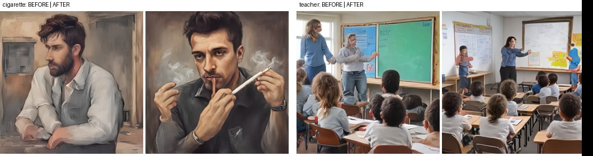

| Prompt typed by the user | Before (auto, 384 px, 1 try) | After (corrected prompt, Quality: best of 4 at 512 px) |
|---|---|---|
| "A guy with ciggerate" | CLIP 22.2, no cigarette | "A guy with cigarette": CLIP 32.6, lit cigarette and smoke |
| "A teacher teaching a classroom with students" | CLIP 29.6, two blurred teachers | CLIP 31.5, one teacher at the board |

#### 5. Anime prompts: real-word typo, character counting, false safety blur

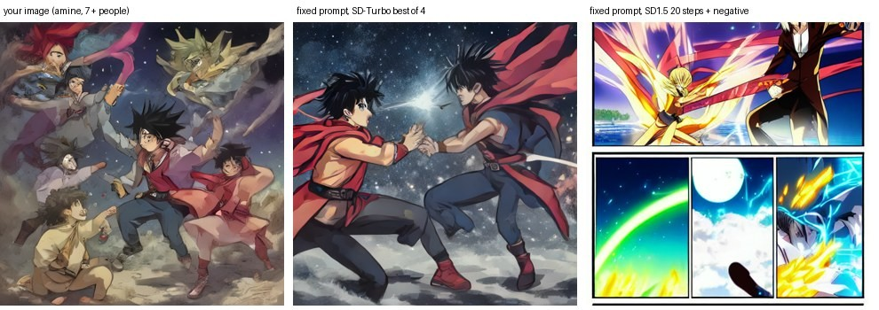

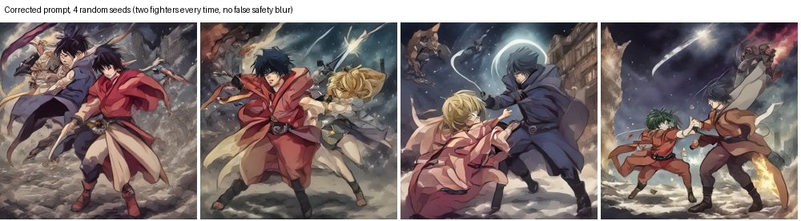

| Problem in "I WANT TWO AMINE CHARACTER FIGHTING IN THE NIGHT…" | Fix | Result |
|---|---|---|
| "amine" is a dictionary word (chemistry) | context typo rule: amine → anime before character/girl/style… | prompt read as "anime" |
| "character" not parsed as a person | character / hero / warrior / teacher / student … → person | 2 people expected |
| anime fights blurred by the zero-shot safety check | drawn-style safe concepts added | 0 of 4 blurred (was 2 of 3) |

#### 6. Face detail pass (before | after, same seed)

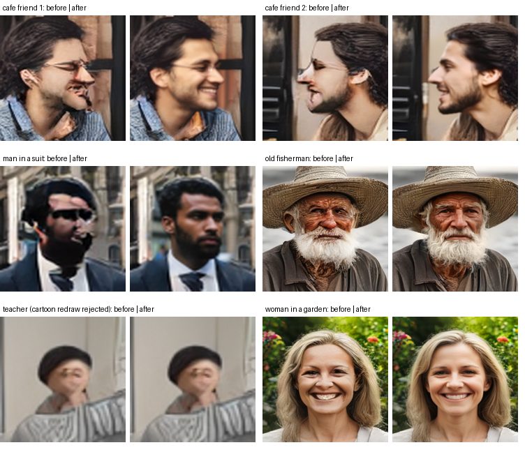

| Step | Method | Setting |
|---|---|---|
| Find faces | OWLv2 open-vocabulary detection, query "face" | score ≥ 0.10, side ≥ 20 px, inside a detected person |
| Depth of field | skip faces < 50 % of the largest face when that one is ≥ 60 px | background stays soft |
| Redraw | 1.6× square crop → 512 px → SD-Turbo image-to-image | strength 0.5 (0.75 if face < 40 px), 4-step schedule |
| Style guard | CLIP-B/32: "photo of a real face" vs "cartoon face" | cartoon redraw in a photo → retry at 0.5 → else keep original |
| Blend | feathered ellipse (Gaussian-blurred mask) | no visible seam |
| Cost | RTX 4060 laptop | ≈ 0.25 s per face, max 3 faces |

#### 7. 8K output: diffusion detail pass + classical super-resolution

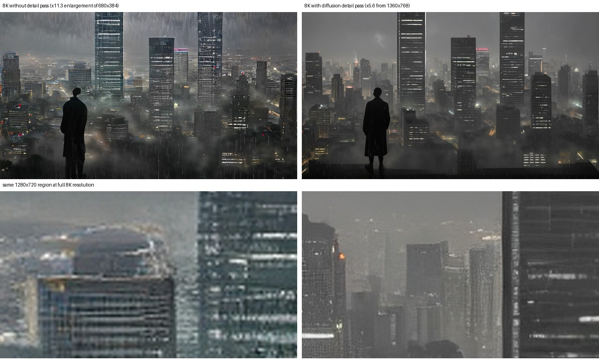

| Output | Native generation | Detail pass | Classical SR | Total |
|---|---|---|---|---|
| 7680×4320 (8K, 16:9) | 680×384, SD-Turbo 1 step | 1360×768, SD-Turbo img2img, 1 UNet call | IBP to ≤ 4K + Lanczos (×5.6) | ≈ 5 s on the laptop GPU |

#### 8. Benchmark plots

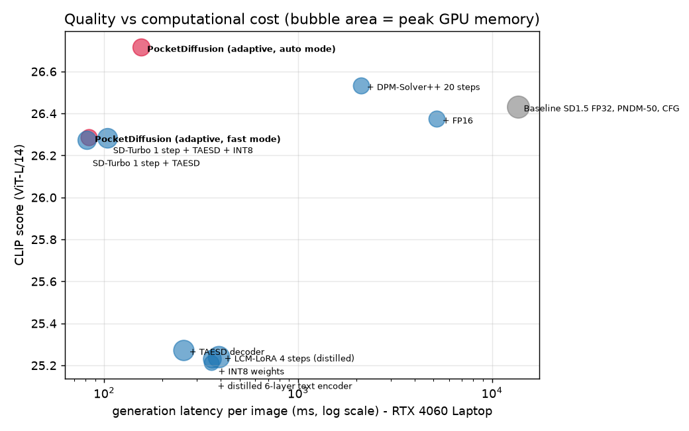

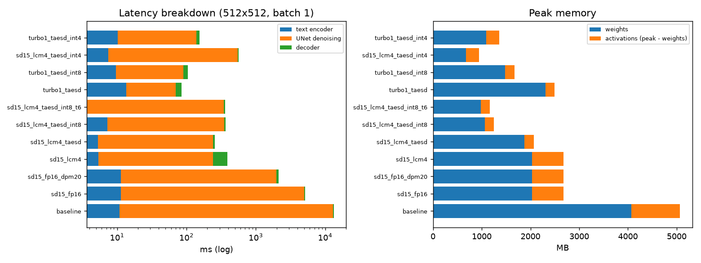

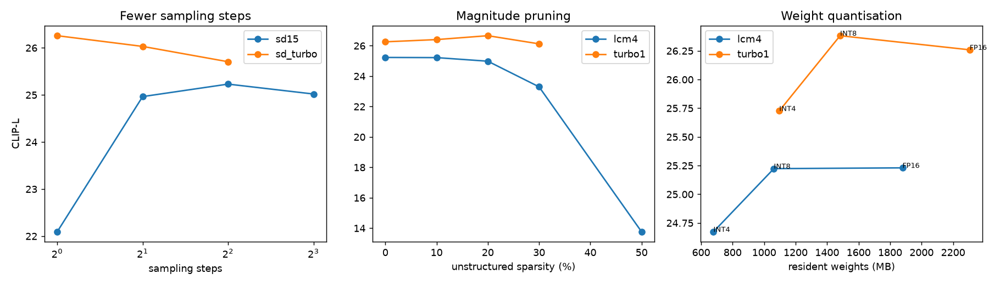

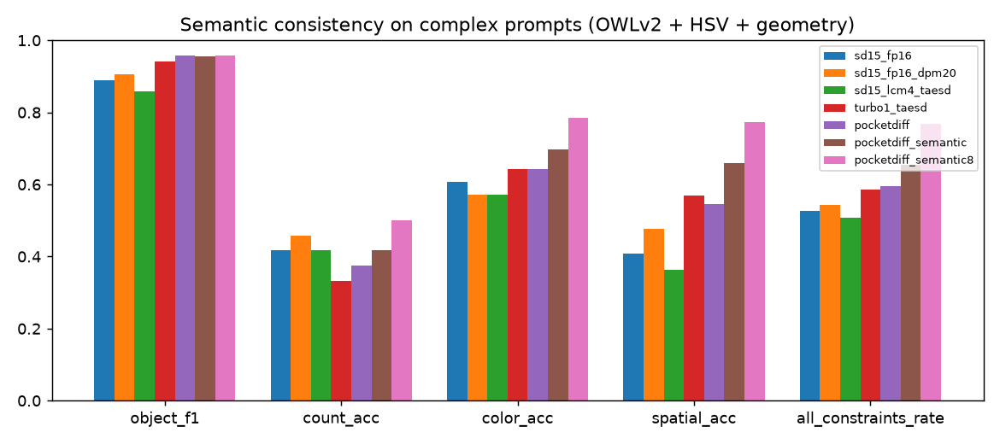

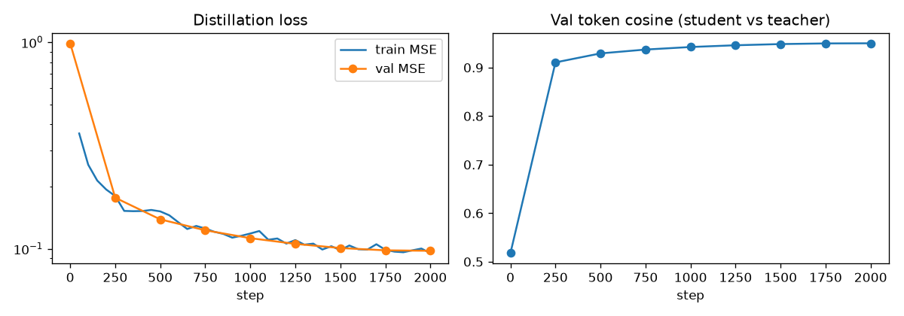

### 3.3 Ablation Study

#### A. Removing one component at a time (100 test prompts)

| Variant | CLIP-L ↑ | NIQE ↓ | Artifact rate ↓ | Latency ms |
|---|---|---|---|---|
| Full system | 26.71 | 3.85 | 0.07 | 305 |
| − best-of-N re-ranking | 26.36 | 3.75 | 0.12 | 169 |
| − classical post-processing | 26.75 | 3.87 | 0.21 | 236 |
| − prompt-complexity adaptation (fixed λ) | 26.38 | 3.77 | 0.09 | 219 |
| − planner (one fixed configuration) | 26.14 | 3.74 | 0.10 | 154 |

#### B. Classical post-processing stages (leave-one-out)

| Variant | CLIP-L ↑ | NIQE ↓ | Artifact rate ↓ | ms / image |
|---|---|---|---|---|
| No post-processing | 26.11 | 3.78 | 0.24 | 0 |
| All stages (adaptive) | 26.16 | 3.74 | 0.10 | 94 |
| All − white balance | 26.16 | 3.74 | 0.21 | 98 |
| All − edge-aware sharpening | 26.11 | 3.78 | 0.12 | 59 |
| All − denoise | 26.16 | 3.74 | 0.11 | 96 |

#### C. Resolution optimisation (generate 384 px, upscale to 512 px)

| Variant | CLIP-L ↑ | NIQE ↓ | Generation ms | Upscale ms |
|---|---|---|---|---|
| Native 512 px | 26.11 | 3.78 | 76 | – |
| 384 → 512 nearest | 26.10 | 6.65 | 54 | 1.8 |
| 384 → 512 bicubic | 26.10 | 5.00 | 54 | 2.3 |
| 384 → 512 Lanczos | 26.07 | 4.98 | 54 | 2.6 |
| 384 → 512 **IBP (ours)** | 26.32 | **3.83** | 54 | 54.0 |

#### D. Semantic re-ranking (58 compositional prompts × 2 seeds)

| System | Object F1 ↑ | All constraints ↑ | Count acc | Colour acc | Spatial acc | ms / image |
|---|---|---|---|---|---|---|
| Baseline SD1.5 FP16, 50 steps | 0.889 | 0.53 | 0.42 | 0.61 | 0.41 | 5,195 |
| PocketDiffusion (auto) | 0.958 | 0.59 | 0.38 | 0.64 | 0.55 | 312 |
| + semantic re-ranking, N = 4 | 0.956 | 0.66 | 0.42 | 0.70 | 0.66 | 485 |
| + semantic re-ranking, N = 8 | 0.959 | 0.77 | 0.50 | 0.79 | 0.77 | 877 |

<!-- TEAM-TODO -->
> ✍️ **Team: write ~90–120 words** interpreting the ablation. Points to explain:
> - The planner gives the largest CLIP gain (+0.57 over one fixed configuration); re-ranking adds +0.35 but costs 136 ms (305 vs 169 ms); complexity adaptation adds +0.33.
> - Post-processing does not change CLIP (it is not supposed to) but cuts the artifact rate 3× (0.21 → 0.07); white balance does most of that work.
> - Honest observation: removing re-ranking gives a *lower* (better) NIQE (3.75 vs 3.85): CLIP prefers detailed, high-contrast candidates that NIQE scores as less natural.
> - IBP upscaling makes 384 px generation look like native 512 px (NIQE 3.83 vs 3.78) while saving 22 ms of GPU time, but IBP itself costs 54 ms on the CPU.
> - Object F1 saturates at ~0.96; the stricter all-constraints rate keeps improving with more candidates.
<!-- /TEAM-TODO -->

---

## 4. Failure Modes & Limitations

| # | Category | Prompt / setting | What went wrong (measured) | Evidence |
|---|---|---|---|---|
| F1 | Counting | "a photo of three apples" | 4 apples (seed 0) and 5 apples (seed 1) | [image](results/failures/pocketdiff_c02_s0.png) |
| F2 | Attribute binding | "a photo of a red cup and a blue book" | the blue went onto the cup's pattern; the book is beige (both seeds) | [image](results/failures/pocketdiff_k09_s0.png) |
| F3 | Spatial relations | "a red apple to the left of a green bottle on a wooden table" | relation violated by all three systems in Figure 2; *complex* category all-constraints rate 0 % (auto) → 30 % (N = 8) | Figure 2, row 4 |
| F4 | Compression | 50 % magnitude pruning of the SD1.5 UNet; SD1.5 at 256 px | CLIP 25.23 → 13.76 (pruning); 25.23 → 15.22 (256 px) | [degradation plot](results/plots/degradation.png) |
| F5 | Evaluation error | "a photo of a red car" | a red car is clearly visible (cropped at the border) but OWLv2 missed it, so it is counted as a missing object | [image](results/failures/pocketdiff_k01_s0.png) |
| F6 | Face detail pass | "two friends laughing at a cafe table" (first version of the pass) | a blurred background figure was sharpened into a floating face | fixed: faces must lie inside a detected person + depth-of-field rule |
| F7 | Safety check | anime fight scenes | 3 of 37 generations falsely blurred as "graphic violence" | fixed: drawn-style safe concepts (Figure 6) |

#### Failure case images

| F1: "three apples" → 4 apples | F1: same prompt, seed 1 → 5 apples | F2: blue on the cup, not the book | F5: red car missed by the evaluator |
|---|---|---|---|
| 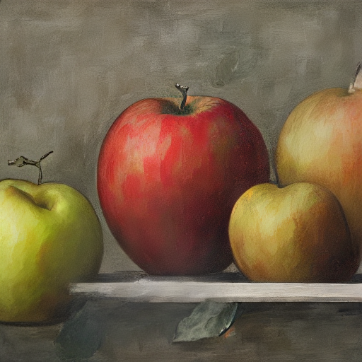 | 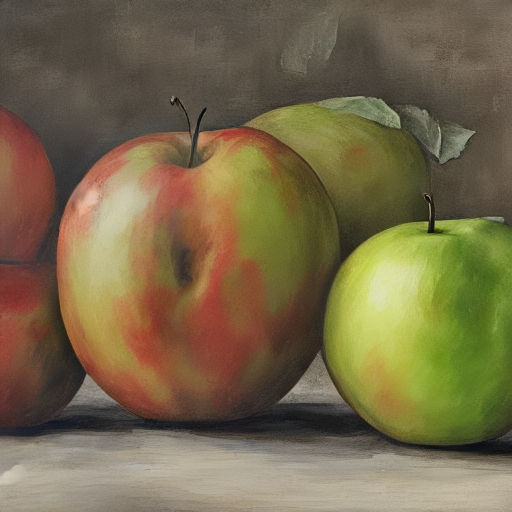 |  |  |

- **Observed Failure Case + Root Cause & Mitigation:**

<!-- TEAM-TODO -->
> ✍️ **Team: for at least three of the rows above write ~50–70 words each: the technical cause and a fix.** Facts:
> - F1: the CLIP text encoder has almost no notion of number ("three" ≈ "some"), and 1-step models cannot correct the object layout later. Mitigation: count-aware re-ranking with a detector (counting all-constraints 50 % → 63 % with N = 8), layout / box-guided generation (GLIGEN-style).
> - F2: cross-attention gets a single text embedding in which adjectives leak between nouns ("red" and "blue" are mixed). Mitigation: Attend-and-Excite style attention guidance, regional prompts per object, semantic re-ranking (colour-binding 25 % → 50 % with N = 8).
> - F3: conditioning is close to a bag of words; "left of" barely changes the embedding. Mitigation: layout planning + box conditioning; semantic re-ranking (spatial 45 % → 85 % with N = 8).
> - F4: unstructured pruning without fine-tuning removes weights the network relies on and gives no speed-up on dense GPUs; SD1.5 was trained at 512 px, so a 32×32 latent is out of distribution. Mitigation: structured pruning + distillation (BK-SDM), the planner never uses pruning and prefers SD-Turbo when it must go to 256 px (CLIP 24.44).
> - F5: detector-based metrics inherit detector errors; about half of the remaining misses are evaluator errors. Mitigation: calibrate the detector threshold on real COCO photos with ground-truth boxes (separate data, never the test results).
<!-- /TEAM-TODO -->

- **Limitations:**

<!-- TEAM-TODO -->
> ✍️ **Team: write ~50–70 words.** Facts: phone latencies are estimates (measured FLOPs ÷ assumed throughput), not on-device measurements; FID on 200 images is biased upwards (compare rows only; KID reported as unbiased); NIQE pristine model is COCO-fitted, not comparable to MATLAB NIQE; the zero-shot safety check is coarse; INT8/INT4 save memory but not GPU time without integer kernels.
<!-- /TEAM-TODO -->

---

## 5. Deployment & Quickstart Guide

**Quickstart Commands**

```bash
# 1. Clone the repository and install dependencies (Python 3.11, NVIDIA GPU recommended)
git clone https://github.com/arpreran/pocketdiffusion.git
cd pocketdiffusion
python -m venv .venv
.venv\Scripts\activate                     # Linux/macOS: source .venv/bin/activate
pip install torch torchvision --index-url https://download.pytorch.org/whl/cu126
pip install -r requirements.txt
python scripts/download_assets.py --core   # public pretrained weights, no token needed

# 2. Run inference on a file of prompts (one per line) -> images + log.json
python generate.py --prompts prompts/samples.txt --out outputs/
python generate.py --prompts prompts/samples.txt --device lowend_phone --out outputs_lowend/

# 3. Full-stack web app (http://127.0.0.1:8000); --share also prints a public link,
#    --publish-link keeps https://arpreran.github.io/pocketdiffusion/ pointing at it
python serve.py --share --publish-link

# 4. Always-on cloud copy (Modal, free credits, CPU)
python -m modal deploy deploy/modal_app.py

# 5. Reproduce every number in this report (~2-3 h on an RTX 4060 laptop)
python -m eval.run_all
python scripts/make_report_figures.py
python scripts/build_report_appendix.py
python scripts/build_report_pdf.py
```

**Deployment Format**

<!-- AI-DRAFTED -->
PocketDiffusion is a full-stack web application. A FastAPI backend (`backend/`) runs every generation on a single GPU worker thread with a job queue and streams progress (plan, denoising previews, post-processing stages) to the browser over Server-Sent Events. Every generation is stored in SQLite with its plan and timings. The web UI (`frontend/`) has Studio, Gallery, Lab (live charts), Race (baseline vs optimised) and About pages. The permanent link opens the laptop-GPU server when it is online and an always-on cloud copy otherwise. A Dockerfile, an alternative Gradio interface (`app.py`) and the command-line tool (`generate.py`) are also provided.
<!-- /AI-DRAFTED -->

#### Deployment architecture

| Component | Where it runs | Address | Role |
|---|---|---|---|
| Permanent demo page | GitHub Pages (static, free) | https://arpreran.github.io/pocketdiffusion/ | checks which server is up and forwards the visitor |
| Main demo server | team laptop, RTX 4060 (8 GB) via Gradio share tunnel | changing `*.gradio.live` URL, published automatically to the page | fast path: ≈ 0.5–1.5 s per image, all features |
| Always-on cloud copy | Modal serverless container, 8 CPU cores / 16 GB, scales to zero | https://arpreran--pocketdiffusion.us-east.modal.run | used when the laptop is offline: ≈ 9–15 s per image |
| Source code + report | GitHub | https://github.com/arpreran/pocketdiffusion | reproducibility |

| Event | What the system does |
|---|---|
| network switch / sleep drops the tunnel | the server checks its public URL every minute, reopens the tunnel after two failures and pushes the new URL to `live.json` on GitHub Pages |
| tunnel client cannot resolve the relay (phone hotspot DNS) | retry with connect-by-IP (TLS still verified against the host name) or public DNS |
| laptop off | the permanent page wakes the Modal copy (cold start ≈ 15–40 s) |

#### Application screenshots


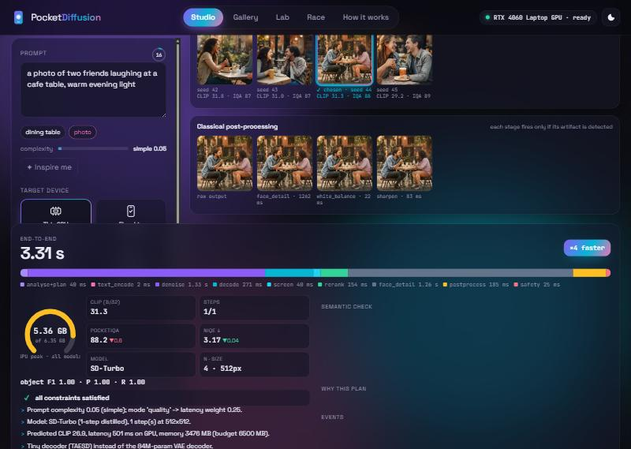

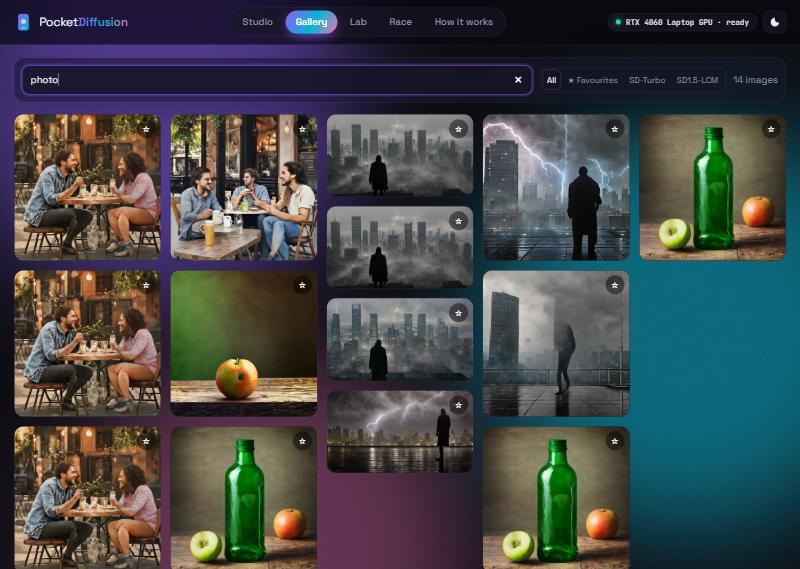


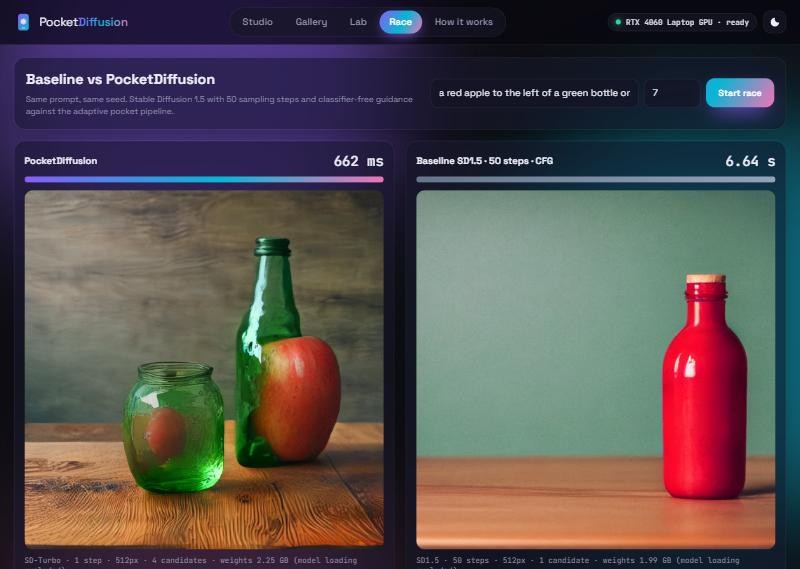

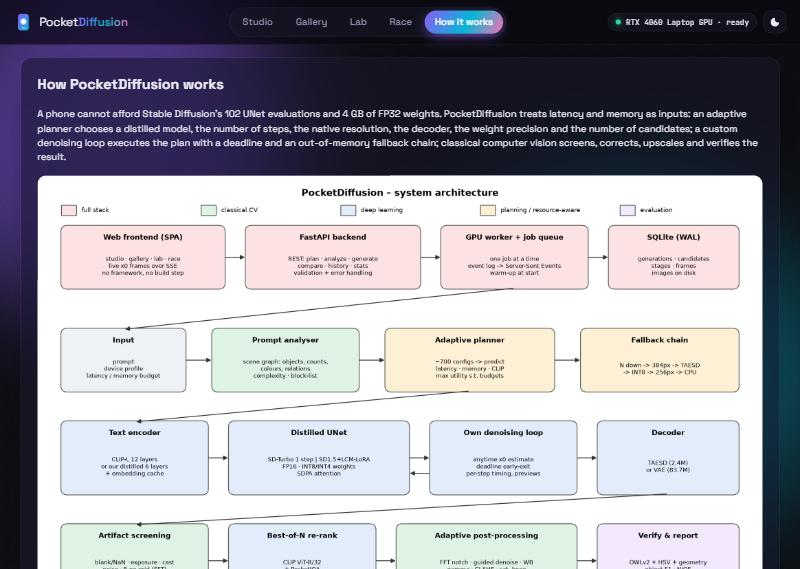

---

## 6. AI-Assistance Declaration

<!-- AI-DRAFTED -->
**Tool:** Claude (Anthropic), used as an AI coding assistant in the development environment.
**System design and code:** the assistant took part in system design discussions and wrote most of the source code (`pocketdiff/`, `backend/`, `frontend/`, `eval/`, `scripts/`). It also wrote the 58 prompts of the compositional benchmark (`prompts/compositional.json`).
**Results:** every number comes from the evaluation scripts in `eval/`, run on our hardware; none were typed in by hand.
**This report:** the text inside AI-drafted blocks (the note in 3.1, the three figure captions, the deployment format and this declaration) was drafted by the assistant. Tables were generated from `results/*.json`. All other text was written by the team.
<!-- /AI-DRAFTED -->

<!-- TEAM-TODO -->
> ✍️ **Team: write what you did yourselves (~50–80 words, honest)**: who reviewed and can explain which modules (see `docs/VIVA_GUIDE.md` for the split), which experiments you ran, which decisions you made, what you changed. Then add one line: "Measured AI share of the report text: __ %" (from `python scripts/ai_share.py Solution_Report_P3.md`).
<!-- /TEAM-TODO -->

---

<!-- APPENDIX:START (generated by scripts/build_report_appendix.py - do not edit by hand) -->

## Appendices

### A. Full evaluation tables

| Source | Generated by |
|---|---|
| `eval_P3_TXX.md` | `python -m eval.make_report` |


#### A.1 CLIP similarity (text-image alignment, ViT-L/14, higher is better)

| system | CLIP score (mean ± s.e.) | Δ vs baseline |
|---|---|---|
| Baseline SD1.5 FP32, PNDM-50, CFG | 26.43 ± 0.22 | 0.00 |
| + FP16 | 26.38 ± 0.23 | -0.06 |
| + DPM-Solver++ 20 steps | 26.53 ± 0.22 | 0.10 |
| + LCM-LoRA 4 steps (distilled) | 25.24 ± 0.22 | -1.19 |
| + TAESD decoder | 25.27 ± 0.21 | -1.16 |
| + INT8 weights | 25.23 ± 0.22 | -1.20 |
| + distilled 6-layer text encoder | 25.21 ± 0.23 | -1.22 |
| SD-Turbo 1 step + TAESD | 26.27 ± 0.21 | -0.16 |
| SD-Turbo 1 step + TAESD + INT8 | 26.28 ± 0.21 | -0.15 |
| **PocketDiffusion (adaptive, auto mode)** | 26.72 ± 0.21 | 0.28 |
| **PocketDiffusion (adaptive, fast mode)** | 26.29 ± 0.21 | -0.15 |
| *Real COCO photos (reference)* | 25.18 | – |


#### A.2 FID / KID (distribution-level realism vs real COCO images, lower is better)

| system | FID | KID ×10³ |
|---|---|---|
| Baseline SD1.5 FP32, PNDM-50, CFG | 150.8 | 3.94 ± 1.82 |
| + FP16 | 151.2 | 3.65 ± 1.28 |
| + DPM-Solver++ 20 steps | 151.4 | 3.07 ± 1.56 |
| + LCM-LoRA 4 steps (distilled) | 157.4 | 8.73 ± 1.61 |
| + TAESD decoder | 158.2 | 8.64 ± 1.59 |
| + INT8 weights | 156.8 | 8.86 ± 1.66 |
| + distilled 6-layer text encoder | 157.0 | 8.25 ± 1.61 |
| SD-Turbo 1 step + TAESD | 150.3 | 5.93 ± 2.20 |
| SD-Turbo 1 step + TAESD + INT8 | 150.7 | 6.72 ± 2.75 |
| **PocketDiffusion (adaptive, auto mode)** | 147.4 | 3.80 ± 1.94 |
| **PocketDiffusion (adaptive, fast mode)** | 147.3 | 3.35 ± 1.73 |

| system | NIQE ↓ | PocketIQA ↑ | artifact rate ↓ |
|---|---|---|---|
| Baseline SD1.5 FP32, PNDM-50, CFG | 4.19 | 87.6 | 0.30 |
| + DPM-Solver++ 20 steps | 4.22 | 87.4 | 0.32 |
| + TAESD decoder | 5.02 | 87.3 | 0.45 |
| SD-Turbo 1 step + TAESD | 3.81 | 87.2 | 0.20 |
| **PocketDiffusion (adaptive, auto mode)** | 3.74 | 87.7 | 0.07 |
| **PocketDiffusion (adaptive, fast mode)** | 3.76 | 88.1 | 0.18 |


#### A.3 Image generation latency (512×512, batch 1, after warm-up)

| system | UNet evals | latency ms | text ms | UNet ms | decode ms | speed-up |
|---|---|---|---|---|---|---|
| Baseline SD1.5 FP32, PNDM-50, CFG | 102 | 13307 ± 7 | 10.9 | 13026 | 270.2 | 1.0× |
| + FP16 | 102 | 5170 ± 4 | 11.4 | 5013 | 145.7 | 2.6× |
| + DPM-Solver++ 20 steps | 40 | 2120 ± 4 | 11.4 | 1962 | 146.1 | 6.3× |
| + LCM-LoRA 4 steps (distilled) | 4 | 388 ± 2 | 5.4 | 237 | 145.5 | 34.3× |
| + TAESD decoder | 4 | 257 ± 1 | 5.3 | 238 | 14.1 | 51.7× |
| + INT8 weights | 4 | 366 ± 5 | 7.2 | 344 | 14.7 | 36.4× |
| + distilled 6-layer text encoder | 4 | 360 ± 3 | 3.7 | 342 | 14.2 | 37.0× |
| SD-Turbo 1 step + TAESD | 1 | 85 ± 8 | 13.6 | 56 | 15.3 | 156.4× |
| SD-Turbo 1 step + TAESD + INT8 | 1 | 104 ± 2 | 9.7 | 81 | 14.2 | 127.5× |
| **PocketDiffusion (adaptive, auto mode)** | adaptive | 155 (gen) / 291 (end-to-end) | – | – | – | 85.7× |
| **PocketDiffusion (adaptive, fast mode)** | adaptive | 83 (gen) / 164 (end-to-end) | – | – | – | 159.6× |

| config | latency ms | peak RSS MB |
|---|---|---|
| CPU fallback 256px, LCM 2 steps, TAESD, FP32 | 1514 | 4286 |
| CPU fallback 384px, LCM 2 steps, TAESD, FP32 | 2708 | 4341 |


#### A.4 Peak memory consumption (CUDA allocator peak during one generation)

| system | peak MB | weights MB | activations MB | reduction |
|---|---|---|---|---|
| Baseline SD1.5 FP32, PNDM-50, CFG | 5065 | 4067 | 998 | 1.0× |
| + FP16 | 2676 | 2034 | 642 | 1.9× |
| + DPM-Solver++ 20 steps | 2676 | 2034 | 642 | 1.9× |
| + LCM-LoRA 4 steps (distilled) | 2675 | 2034 | 641 | 1.9× |
| + TAESD decoder | 2068 | 1879 | 189 | 2.4× |
| + INT8 weights | 1246 | 1062 | 184 | 4.1× |
| + distilled 6-layer text encoder | 1162 | 981 | 181 | 4.4× |
| SD-Turbo 1 step + TAESD | 2489 | 2305 | 183 | 2.0× |
| SD-Turbo 1 step + TAESD + INT8 | 1671 | 1483 | 188 | 3.0× |


#### A.5 Model size

| system | UNet M params | text-enc M | decoder M | total M | size MB | compression |
|---|---|---|---|---|---|---|
| Baseline SD1.5 FP32, PNDM-50, CFG | 859.5 | 123.1 | 83.65 | 1066.2 | 4067 | 1.0× |
| + FP16 | 859.5 | 123.1 | 83.65 | 1066.2 | 2034 | 2.0× |
| + DPM-Solver++ 20 steps | 859.5 | 123.1 | 83.65 | 1066.2 | 2034 | 2.0× |
| + LCM-LoRA 4 steps (distilled) | 859.5 | 123.1 | 83.65 | 1066.2 | 2034 | 2.0× |
| + TAESD decoder | 859.5 | 123.1 | 2.45 | 985.0 | 1879 | 2.2× |
| + INT8 weights | 859.5 | 123.1 | 2.45 | 985.0 | 1062 | 3.8× |
| + distilled 6-layer text encoder | 859.5 | 80.5 | 2.45 | 942.5 | 981 | 4.1× |
| SD-Turbo 1 step + TAESD | 865.9 | 340.4 | 2.45 | 1208.7 | 2305 | 1.8× |
| SD-Turbo 1 step + TAESD + INT8 | 865.9 | 340.4 | 2.45 | 1208.7 | 1483 | 2.7× |
| + INT4 weights | 859.5 | 123.1 | 2.45 | 985.0 | 678 | 6.0× |
| SD-Turbo 1 step + TAESD + INT4 | 865.9 | 340.4 | 2.45 | 1208.7 | 1096 | 3.7× |


#### A.6 Quality versus computational cost

| system | TFLOPs / image | latency ms | peak MB | CLIP | FID | CLIP per TFLOP |
|---|---|---|---|---|---|---|
| Baseline SD1.5 FP32, PNDM-50, CFG | 84.48 | 13307 | 5065 | 26.43 | 150.8 | 0.31 |
| + FP16 | 84.48 | 5170 | 2676 | 26.38 | 151.2 | 0.31 |
| + DPM-Solver++ 20 steps | 34.67 | 2120 | 2676 | 26.53 | 151.4 | 0.77 |
| + LCM-LoRA 4 steps (distilled) | 5.74 | 388 | 2675 | 25.24 | 157.4 | 4.40 |
| + TAESD decoder | 3.37 | 257 | 2068 | 25.27 | 158.2 | 7.50 |
| + INT8 weights | 3.37 | 366 | 1246 | 25.23 | 156.8 | 7.49 |
| + distilled 6-layer text encoder | 3.36 | 360 | 1162 | 25.21 | 157.0 | 7.50 |
| SD-Turbo 1 step + TAESD | 0.99 | 85 | 2489 | 26.27 | 150.3 | 26.52 |
| SD-Turbo 1 step + TAESD + INT8 | 0.99 | 104 | 1671 | 26.28 | 150.7 | 26.53 |


#### A.7 Semantic consistency on complex prompts (multiple objects, attributes, spatial relations)

| system | precision | recall | **object F1** | count acc | colour acc | spatial acc | all constraints | CLIP | ms / image |
|---|---|---|---|---|---|---|---|---|---|
| Baseline SD1.5 FP16, 50 steps, CFG | 0.971 | 0.820 | 0.889 | 0.42 | 0.61 | 0.41 | 0.53 | 26.72 | 5195 |
| SD1.5 DPM-Solver++ 20 steps | 0.957 | 0.859 | 0.905 | 0.46 | 0.57 | 0.48 | 0.54 | 26.75 | 2138 |
| SD1.5 + LCM 4 steps + TAESD | 0.970 | 0.772 | 0.859 | 0.42 | 0.57 | 0.36 | 0.51 | 26.02 | 283 |
| SD-Turbo 1 step + TAESD | 0.964 | 0.917 | 0.940 | 0.33 | 0.64 | 0.57 | 0.59 | 27.25 | 106 |
| **PocketDiffusion (auto)** | 0.980 | 0.937 | 0.958 | 0.38 | 0.64 | 0.55 | 0.59 | 27.64 | 312 |
| PocketDiffusion + semantic re-ranking, N=4 ‡ | 0.970 | 0.942 | 0.956 | 0.42 | 0.70 | 0.66 | 0.66 | 27.56 | 485 |
| PocketDiffusion + semantic re-ranking, N=8 ‡ | 0.957 | 0.961 | 0.959 | 0.50 | 0.79 | 0.77 | 0.77 | 27.90 | 877 |


#### A.8 Resource requirements for mobile deployment targets

| device profile | memory budget MB | assumed TFLOPS | plan chosen by planner | pred. MB | pred. ms | status |
|---|---|---|---|---|---|---|
| This machine (GPU, measured) | 6500 | – | sd_turbo euler-1 @512px, none, taesd, TE=full, N=4 | 3476 | 501 | fits |
| Flagship phone NPU (simulated) | 3000 | 4.0 | sd_turbo euler-1 @384px, int8, taesd, TE=full, N=4 | 2297 | 533 | fits |
| Mid-range phone (simulated) | 1800 | 1.2 | sd_turbo euler-1 @384px, int8, taesd, TE=full, N=1 | 1675 | 448 | fits |
| Low-end phone (simulated) | 1100 | 0.3 | sd15 lcm-2 @256px, int8, taesd, TE=t6, N=1 | 1090 | 1477 | fits |
| This machine (CPU only, measured) | 6000 | – | sd_turbo euler-1 @384px, none, taesd, TE=full, N=1 | 2524 | 2791 | fits |


#### A.9 Quality degradation from compression / fewer steps (validation split)

| run | group | family | steps | px | weights | sparsity | TE | decoder | N | CLIP-L | gen ms | weights MB |
|---|---|---|---|---|---|---|---|---|---|---|---|---|
| lcm4 | base | sd15 | 4 | 512 | none | 0.0 | full | taesd | 1 | 25.23 ± 0.46 | 256 | 1879 |
| turbo1 | base | sd_turbo | 1 | 512 | none | 0.0 | full | taesd | 1 | 26.26 ± 0.39 | 78 | 2305 |
| lcm_steps1 | steps | sd15 | 1 | 512 | none | 0.0 | full | taesd | 1 | 22.09 ± 0.52 | 87 | 1879 |
| lcm_steps2 | steps | sd15 | 2 | 512 | none | 0.0 | full | taesd | 1 | 24.97 ± 0.41 | 134 | 1879 |
| lcm_steps4 | steps | sd15 | 4 | 512 | none | 0.0 | full | taesd | 1 | 25.23 ± 0.46 | 253 | 1879 |
| lcm_steps8 | steps | sd15 | 8 | 512 | none | 0.0 | full | taesd | 1 | 25.02 ± 0.45 | 490 | 1879 |
| dpm_steps20 | steps | sd15 | 20 | 512 | none | 0.0 | full | taesd | 1 | 26.47 ± 0.43 | 1976 | 1879 |
| turbo_steps1 | steps | sd_turbo | 1 | 512 | none | 0.0 | full | taesd | 1 | 26.26 ± 0.39 | 82 | 2305 |
| turbo_steps2 | steps | sd_turbo | 2 | 512 | none | 0.0 | full | taesd | 1 | 26.03 ± 0.38 | 123 | 2305 |
| turbo_steps4 | steps | sd_turbo | 4 | 512 | none | 0.0 | full | taesd | 1 | 25.71 ± 0.39 | 233 | 2305 |
| lcm4_256px | resolution | sd15 | 4 | 256 | none | 0.0 | full | taesd | 1 | 15.22 ± 0.51 | 151 | 1879 |
| lcm4_384px | resolution | sd15 | 4 | 384 | none | 0.0 | full | taesd | 1 | 23.89 ± 0.46 | 182 | 1879 |
| turbo1_256px | resolution | sd_turbo | 1 | 256 | none | 0.0 | full | taesd | 1 | 24.44 ± 0.41 | 48 | 2305 |
| turbo1_384px | resolution | sd_turbo | 1 | 384 | none | 0.0 | full | taesd | 1 | 26.26 ± 0.41 | 50 | 2305 |
| lcm4_int8 | quant | sd15 | 4 | 512 | int8 | 0.0 | full | taesd | 1 | 25.22 ± 0.48 | 363 | 1062 |
| lcm4_int4 | quant | sd15 | 4 | 512 | int4 | 0.0 | full | taesd | 1 | 24.67 ± 0.43 | 558 | 678 |
| turbo1_int8 | quant | sd_turbo | 1 | 512 | int8 | 0.0 | full | taesd | 1 | 26.38 ± 0.40 | 107 | 1483 |
| turbo1_int4 | quant | sd_turbo | 1 | 512 | int4 | 0.0 | full | taesd | 1 | 25.73 ± 0.36 | 157 | 1096 |
| lcm4_prune10 | prune | sd15 | 4 | 512 | none | 0.1 | full | taesd | 1 | 25.22 ± 0.46 | 259 | 1879 |
| lcm4_prune20 | prune | sd15 | 4 | 512 | none | 0.2 | full | taesd | 1 | 24.98 ± 0.49 | 259 | 1879 |
| lcm4_prune30 | prune | sd15 | 4 | 512 | none | 0.3 | full | taesd | 1 | 23.30 ± 0.53 | 259 | 1879 |
| lcm4_prune50 | prune | sd15 | 4 | 512 | none | 0.5 | full | taesd | 1 | 13.76 ± 0.32 | 256 | 1879 |
| turbo1_prune10 | prune | sd_turbo | 1 | 512 | none | 0.1 | full | taesd | 1 | 26.41 ± 0.39 | 82 | 2305 |
| turbo1_prune20 | prune | sd_turbo | 1 | 512 | none | 0.2 | full | taesd | 1 | 26.66 ± 0.42 | 76 | 2305 |
| turbo1_prune30 | prune | sd_turbo | 1 | 512 | none | 0.3 | full | taesd | 1 | 26.13 ± 0.34 | 76 | 2305 |
| lcm4_t6 | text_encoder | sd15 | 4 | 512 | none | 0.0 | t6 | taesd | 1 | 25.14 ± 0.43 | 254 | 1798 |
| lcm4_fullvae | decoder | sd15 | 4 | 512 | none | 0.0 | full | full | 1 | 24.96 ± 0.47 | 387 | 2034 |
| turbo1_fullvae | decoder | sd_turbo | 1 | 512 | none | 0.0 | full | full | 1 | 26.15 ± 0.40 | 208 | 2460 |
| lcm4_best_of_2 | rerank | sd15 | 4 | 512 | none | 0.0 | full | taesd | 2 | 25.36 ± 0.42 | 426 | 1879 |
| lcm4_best_of_4 | rerank | sd15 | 4 | 512 | none | 0.0 | full | taesd | 4 | 26.53 ± 0.40 | 770 | 1879 |
| turbo1_best_of_2 | rerank | sd_turbo | 1 | 512 | none | 0.0 | full | taesd | 2 | 26.56 ± 0.39 | 128 | 2305 |
| turbo1_best_of_4 | rerank | sd_turbo | 1 | 512 | none | 0.0 | full | taesd | 4 | 26.92 ± 0.40 | 220 | 2305 |


#### A.10 Ablation study


##### A. System components

| variant | CLIP-L | PocketIQA | NIQE↓ | artifact rate | latency ms |
|---|---|---|---|---|---|
| full_system | 26.71 | 87.0 | 3.85 | 0.07 | 305 |
| minus_rerank | 26.36 | 87.1 | 3.75 | 0.12 | 169 |
| minus_postprocess | 26.75 | 86.9 | 3.87 | 0.21 | 236 |
| minus_complexity_adaptation | 26.38 | 86.9 | 3.77 | 0.09 | 219 |
| minus_planner_fixed_config | 26.14 | 86.9 | 3.74 | 0.10 | 154 |


##### B. Classical post-processing stages (leave-one-out)

| variant | CLIP-L | PocketIQA | NIQE↓ | artifact rate | ms / image |
|---|---|---|---|---|---|
| none | 26.11 | 87.0 | 3.78 | 0.24 | 0 |
| all | 26.16 | 86.9 | 3.74 | 0.10 | 94 |
| all_minus_grid_notch | 26.16 | 86.9 | 3.74 | 0.10 | 104 |
| all_minus_denoise | 26.16 | 86.9 | 3.74 | 0.11 | 96 |
| all_minus_white_balance | 26.16 | 87.1 | 3.74 | 0.21 | 98 |
| all_minus_adaptive_gamma | 26.16 | 86.9 | 3.74 | 0.10 | 94 |
| all_minus_clahe | 26.16 | 86.9 | 3.74 | 0.10 | 94 |
| all_minus_saturation_knee | 26.16 | 86.9 | 3.74 | 0.10 | 94 |
| all_minus_sharpen | 26.11 | 86.9 | 3.78 | 0.12 | 59 |


##### C. Resolution optimisation

| variant | CLIP-L | PocketIQA | NIQE↓ | gen ms | upscale ms |
|---|---|---|---|---|---|
| native_512 | 26.11 | 87.0 | 3.78 | 76 | – |
| 384_to_512_nearest | 26.10 | 86.2 | 6.65 | 54 | 1.8 |
| 384_to_512_bilinear | 25.91 | 83.8 | 5.90 | 54 | 2.4 |
| 384_to_512_bicubic | 26.10 | 85.8 | 5.00 | 54 | 2.3 |
| 384_to_512_lanczos | 26.07 | 86.1 | 4.98 | 54 | 2.6 |
| 384_to_512_ibp | 26.32 | 87.5 | 3.83 | 54 | 54.0 |


### B. Compositional benchmark (58 annotated prompts × 2 seeds)

#### B.1 All-constraints rate per category

| Category | Prompts | Baseline SD1.5 50 steps | PocketDiffusion | + semantic re-rank N=8 |
|---|---|---|---|---|
| single | 8 | 94 % | 100 % | 100 % |
| two_objects | 10 | 75 % | 100 % | 100 % |
| counting | 8 | 44 % | 50 % | 62 % |
| colors | 8 | 62 % | 88 % | 100 % |
| color_binding | 4 | 38 % | 25 % | 50 % |
| spatial | 10 | 45 % | 45 % | 85 % |
| complex | 10 | 10 % | 0 % | 30 % |

#### B.2 Prompts and annotations

| ID | Category | Prompt | Objects (count, colour) | Relations |
|---|---|---|---|---|
| s01 | single | a photo of a dog | dog | – |
| s02 | single | a photo of a bicycle | bicycle | – |
| s03 | single | a photo of a clock | clock | – |
| s04 | single | a photo of a pizza | pizza | – |
| s05 | single | a photo of a giraffe | giraffe | – |
| s06 | single | a photo of an umbrella | umbrella | – |
| s07 | single | a photo of a laptop | laptop | – |
| s08 | single | a photo of a teddy bear | teddy bear | – |
| t01 | two_objects | a photo of a cat and a laptop | cat, laptop | – |
| t02 | two_objects | a photo of a dog and a frisbee | dog, frisbee | – |
| t03 | two_objects | a photo of a horse and a car | horse, car | – |
| t04 | two_objects | a photo of a cup and a book | cup, book | – |
| t05 | two_objects | a photo of a bench and a bird | bench, bird | – |
| t06 | two_objects | a photo of an elephant and a boat | elephant, boat | – |
| t07 | two_objects | a photo of a banana and a clock | banana, clock | – |
| t08 | two_objects | a photo of a toaster and a vase | toaster, vase | – |
| t09 | two_objects | a photo of a skateboard and a backpack | skateboard, backpack | – |
| t10 | two_objects | a photo of a pizza and a wine glass | pizza, wine glass | – |
| c01 | counting | a photo of two dogs | dog ×2 | – |
| c02 | counting | a photo of three apples | apple ×3 | – |
| c03 | counting | a photo of two cups | cup ×2 | – |
| c04 | counting | a photo of four bananas | banana ×4 | – |
| c05 | counting | a photo of two birds | bird ×2 | – |
| c06 | counting | a photo of three oranges | orange ×3 | – |
| c07 | counting | a photo of two cars | car ×2 | – |
| c08 | counting | a photo of three books | book ×3 | – |
| k01 | colors | a photo of a red car | car (red) | – |
| k02 | colors | a photo of a blue umbrella | umbrella (blue) | – |
| k03 | colors | a photo of a yellow bus | bus (yellow) | – |
| k04 | colors | a photo of a green apple | apple (green) | – |
| k05 | colors | a photo of a white cat | cat (white) | – |
| k06 | colors | a photo of a purple vase | vase (purple) | – |
| k07 | colors | a photo of a black dog | dog (black) | – |
| k08 | colors | a photo of a pink cake | cake (pink) | – |
| k09 | color_binding | a photo of a red cup and a blue book | cup (red), book (blue) | – |
| k10 | color_binding | a photo of a yellow umbrella and a green bench | umbrella (yellow), bench (green) | – |
| k11 | color_binding | a photo of a white car and a red bicycle | car (white), bicycle (red) | – |
| k12 | color_binding | a photo of a black cat and a white dog | cat (black), dog (white) | – |
| p01 | spatial | a photo of a dog to the left of a bicycle | dog, bicycle | dog left of bicycle |
| p02 | spatial | a photo of a cup to the right of a laptop | cup, laptop | cup right of laptop |
| p03 | spatial | a photo of a clock above a bed | clock, bed | clock above bed |
| p04 | spatial | a photo of a cat below a chair | cat, chair | cat below chair |
| p05 | spatial | a photo of a bird above a bench | bird, bench | bird above bench |
| p06 | spatial | a photo of a car to the left of a truck | car, truck | car left of truck |
| p07 | spatial | a photo of a teddy bear on top of a chair | teddy bear, chair | teddy bear above chair |
| p08 | spatial | a photo of a vase to the right of a book | vase, book | vase right of book |
| p09 | spatial | a photo of a horse next to a car | horse, car | horse next to car |
| p10 | spatial | a photo of an umbrella above a dog | umbrella, dog | umbrella above dog |
| x01 | complex | a red apple to the left of a green bottle on a wooden table | apple (red), bottle (green), dining table | apple left of bottle, bottle above dining table |
| x02 | complex | two cats sleeping on a blue couch next to a laptop | cat ×2, couch (blue), laptop | cat above couch, couch next to laptop |
| x03 | complex | a yellow bus parked in front of a red building with a person on a bicycle | bus (yellow), person, bicycle | person above bicycle |
| x04 | complex | three oranges in a white bowl next to a knife | orange ×3, bowl (white), knife | bowl next to knife |
| x05 | complex | a black dog and a white cat sitting on a red bench in a park | dog (black), cat (white), bench (red) | cat above bench |
| x06 | complex | a laptop to the left of a cup of coffee and a potted plant on a desk | laptop, cup, potted plant, dining table | laptop left of cup, potted plant above dining table |
| x07 | complex | a person holding a blue umbrella next to a yellow taxi on a rainy street | person, umbrella (blue), car (yellow) | umbrella next to car |
| x08 | complex | two horses standing in a field beside a white truck | horse ×2, truck (white) | – |
| x09 | complex | a green bicycle leaning on a bench under a clock | bicycle (green), bench, clock | bench below clock |
| x10 | complex | a pizza and two wine glasses on a table next to a vase of flowers | pizza, wine glass ×2, dining table, vase | dining table next to vase |

### C. Device profiles used by the planner

| Key | Profile | Kind | Memory budget | Assumed TFLOPS | Runs on |
|---|---|---|---|---|---|
| `this_gpu` | This machine (GPU, measured) | measured | 6,500 MB | – (measured) | cuda |
| `flagship_phone` | Flagship phone NPU (simulated) | simulated | 3,000 MB | 4.0 | cuda |
| `midrange_phone` | Mid-range phone (simulated) | simulated | 1,800 MB | 1.2 | cuda |
| `lowend_phone` | Low-end phone (simulated) | simulated | 1,100 MB | 0.3 | cuda |
| `this_cpu` | This machine (CPU only, measured) | measured | 6,000 MB | – (measured) | cpu |

### D. Generation presets

| Preset | Family | Precision | Scheduler | Steps | CFG | LCM-LoRA | Decoder | Weights | Text encoder | Size |
|---|---|---|---|---|---|---|---|---|---|---|
| `baseline` | sd15 | fp32 | pndm | 50 | 7.5 | no | full | none | full | 512×512 |
| `sd15_fp16` | sd15 | fp16 | pndm | 50 | 7.5 | no | full | none | full | 512×512 |
| `sd15_fp16_dpm20` | sd15 | fp16 | dpm | 20 | 7.5 | no | full | none | full | 512×512 |
| `sd15_lcm4` | sd15 | fp16 | lcm | 4 | 1.0 | yes | full | none | full | 512×512 |
| `sd15_lcm4_taesd` | sd15 | fp16 | lcm | 4 | 1.0 | yes | taesd | none | full | 512×512 |
| `sd15_lcm4_taesd_int8` | sd15 | fp16 | lcm | 4 | 1.0 | yes | taesd | int8 | full | 512×512 |
| `sd15_lcm4_taesd_int8_t6` | sd15 | fp16 | lcm | 4 | 1.0 | yes | taesd | int8 | t6 | 512×512 |
| `turbo1_taesd` | sd_turbo | fp16 | euler | 1 | 0.0 | no | taesd | none | full | 512×512 |
| `turbo1_taesd_int8` | sd_turbo | fp16 | euler | 1 | 0.0 | no | taesd | int8 | full | 512×512 |
| `cpu_fallback` | sd15 | fp32 | lcm | 2 | 1.0 | yes | taesd | none | full | 256×256 |

### E. REST API (FastAPI backend)

| Method | Path | Purpose |
|---|---|---|
| GET | `/api/system` | hardware, models, queue, device profiles, presets, examples |
| POST | `/api/analyze` | prompt -> scene graph, complexity, token count   (CPU, instant) |
| POST | `/api/plan` | prompt + budget -> planner decision              (CPU, instant) |
| POST | `/api/generate` | enqueue a generation job -> {job_id} |
| POST | `/api/compare` | enqueue baseline-vs-optimised race -> {job_id} |
| GET | `/api/jobs/{id}/events` | Server-Sent Events: queued/start/analysis/plan/step/stage/result/error/end |
| GET | `/api/generations` | history (paginated, filter: favorites, family, q) |
| GET | `/api/generations/{id}` | full record (candidates, stages, frames, metrics) |
| GET | `/api/stats` | aggregate statistics from the database |
| GET | `/api/benchmarks` | evaluation results (results/*.json) for the Lab charts |
| GET | `/media/...` | stored images;  GET /  -> single-page frontend |

### F. Automated tests

| Command | Result |
|---|---|
| `python -m pytest -q tests` | `36 passed in 6.34s` |

| # | Test file | Test |
|---|---|---|
| 1 | `tests/test_api.py` | `test_index_and_static` |
| 2 | `tests/test_api.py` | `test_analyze` |
| 3 | `tests/test_api.py` | `test_plan_respects_device` |
| 4 | `tests/test_api.py` | `test_validation_errors[body0]` |
| 5 | `tests/test_api.py` | `test_validation_errors[body1]` |
| 6 | `tests/test_api.py` | `test_validation_errors[body2]` |
| 7 | `tests/test_api.py` | `test_validation_errors[body3]` |
| 8 | `tests/test_api.py` | `test_generate_rejects_empty_prompt` |
| 9 | `tests/test_api.py` | `test_history_and_stats_on_empty_db` |
| 10 | `tests/test_api.py` | `test_db_roundtrip` |
| 11 | `tests/test_core.py` | `test_parser_objects[a photo of two dogs-expect0]` |
| 12 | `tests/test_core.py` | `test_parser_objects[a red cup and a blue book-expect1]` |
| 13 | `tests/test_core.py` | `test_parser_objects[three oranges in a white bowl-expect2]` |
| 14 | `tests/test_core.py` | `test_parser_objects[an orange cat on a sofa-expect3]` |
| 15 | `tests/test_core.py` | `test_parser_objects[a pizza and two wine glasses-expect4]` |
| 16 | `tests/test_core.py` | `test_parser_objects[a yellow bus-expect5]` |
| 17 | `tests/test_core.py` | `test_parser_relations_and_complexity` |
| 18 | `tests/test_core.py` | `test_bad_prompts` |
| 19 | `tests/test_core.py` | `test_guided_filter_preserves_constant_and_edges` |
| 20 | `tests/test_core.py` | `test_grid_detector` |
| 21 | `tests/test_core.py` | `test_artifact_detection_flags` |
| 22 | `tests/test_core.py` | `test_postprocess_improves_dark_noisy_image` |
| 23 | `tests/test_core.py` | `test_postprocess_leaves_clean_image_mostly_alone` |
| 24 | `tests/test_core.py` | `test_resize_and_snap` |
| 25 | `tests/test_core.py` | `test_iqa_runs_and_orders` |
| 26 | `tests/test_core.py` | `test_ensure_rgb_uint8_handles_odd_inputs` |
| 27 | `tests/test_core.py` | `test_quantization_roundtrip` |
| 28 | `tests/test_core.py` | `test_planner_respects_budgets` |
| 29 | `tests/test_core.py` | `test_short_prompt_chunking_equals_standard_encoding` |
| 30 | `tests/test_core.py` | `test_long_prompt_is_split_into_chunks_not_truncated` |
| 31 | `tests/test_core.py` | `test_output_size_keywords` |
| 32 | `tests/test_core.py` | `test_super_resolve_8k_shape_and_range` |
| 33 | `tests/test_core.py` | `test_snap_resolution_keeps_aspect_for_8k` |
| 34 | `tests/test_core.py` | `test_spelling_correction_only_fixes_real_typos` |
| 35 | `tests/test_core.py` | `test_real_word_typos_fixed_only_in_context_and_characters_counted` |
| 36 | `tests/test_core.py` | `test_face_pass_helpers` |

### G. Hardware and software environment

| Item | Value |
|---|---|
| GPU | NVIDIA GeForce RTX 4060 Laptop GPU (8 GB) |
| CPU | Intel64 Family 6 Model 186 Stepping 2, GenuineIntel |
| PyTorch | 2.14.1+cu126 |
| Benchmarks measured | 2026-11-06 20:08 |
| accelerate | 1.15.0 |
| diffusers | 0.42.1 |
| gradio | 6.31.0 |
| hf-xet | 1.8.0 |
| huggingface_hub | 2.4.0 |
| matplotlib | 3.11.2 |
| numpy | 2.4.6 |
| opencv-python-headless | 5.0.0.93 |
| pandas | 3.1.1 |
| peft | 0.21.2 |
| pillow | 12.3.0 |
| psutil | 7.2.2 |
| pyarrow | 26.0.1 |
| pytest | 9.2.0 |
| requests | 2.34.2 |
| safetensors | 0.8.0 |
| scipy | 1.17.1 |
| torchmetrics | 1.9.0 |
| tqdm | 4.70.1 |
| transformers | 5.22.1 |
| torch_fidelity | 0.4.0 |
| pyspellchecker | 0.8.3 |

### H. Repository structure

```
serve.py                   one-command start of the full-stack app (--share for a public link)
generate.py                command-line inference: prompts file -> images + log.json
Solution_Report_P3.md      solution report (hackathon template); check AI share: scripts/ai_share.py
frontend/                  index.html, styles.css, app.js  (the web UI)
backend/                   main.py (FastAPI routes), jobs.py (GPU worker + SSE), db.py (SQLite)
app.py                     alternative Gradio interface
pocketdiff/
  config.py                model ids, generation presets, device profiles
  prompt_analyzer.py       scene graph + complexity + safety block-list
  planner.py               budget-aware adaptive planner (cost / quality models)
  engine.py                model cache, own denoising loop, anytime exit, OOM fallback, FLOP counting
  optimizations.py         INT8/INT4 weight-only quantisation, pruning, attention
  pipeline.py              orchestrator: plan -> generate -> screen -> re-rank -> post-process -> verify
  scoring.py               CLIP scoring (re-rank B/32, evaluation L/14) + zero-shot safety check
  verifier.py              OWLv2 + HSV colour + geometry compositional verification
  classical/               filters, enhancement, artifacts, IQA (NIQE), resizing, post-processor
scripts/                   asset download, data preparation, NIQE fitting, text-encoder distillation,
                           report figures, AI-share checker
eval/                      efficiency, quality (CLIP/FID/KID), degradation, compositional F1, ablation, report
prompts/compositional.json annotated complex-prompt benchmark (58 prompts, written with AI assistance)
prompts/samples.txt        example prompts for generate.py
tests/                     unit tests (python -m pytest -q)
docs/                      architecture diagram, design-doc template, AI declaration
```

<!-- APPENDIX:END -->

---

## Student Submission Checklist

- [ ] Working GitHub repository link included with an updated `README.md`.
- [ ] No raw code pasted into this report.
- [ ] All table metrics match test runs reproducible via the repository (`python -m eval.run_all`).
- [ ] All team member details accurately recorded (`team.json` filled, then `python -m eval.make_report` re-run).
- [ ] Live demo link tested from a phone on mobile data.
- [ ] `python scripts/ai_share.py Solution_Report_P3.md` reports PASS (≤ 30 % AI text, no placeholders left).
