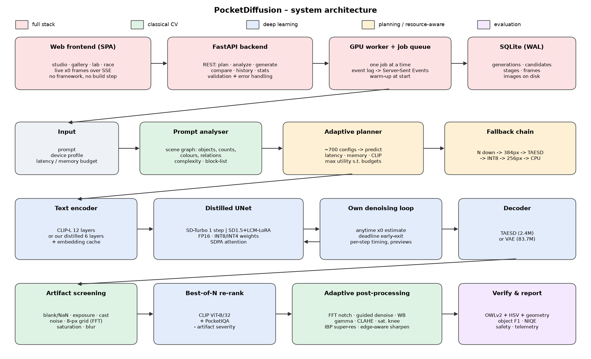
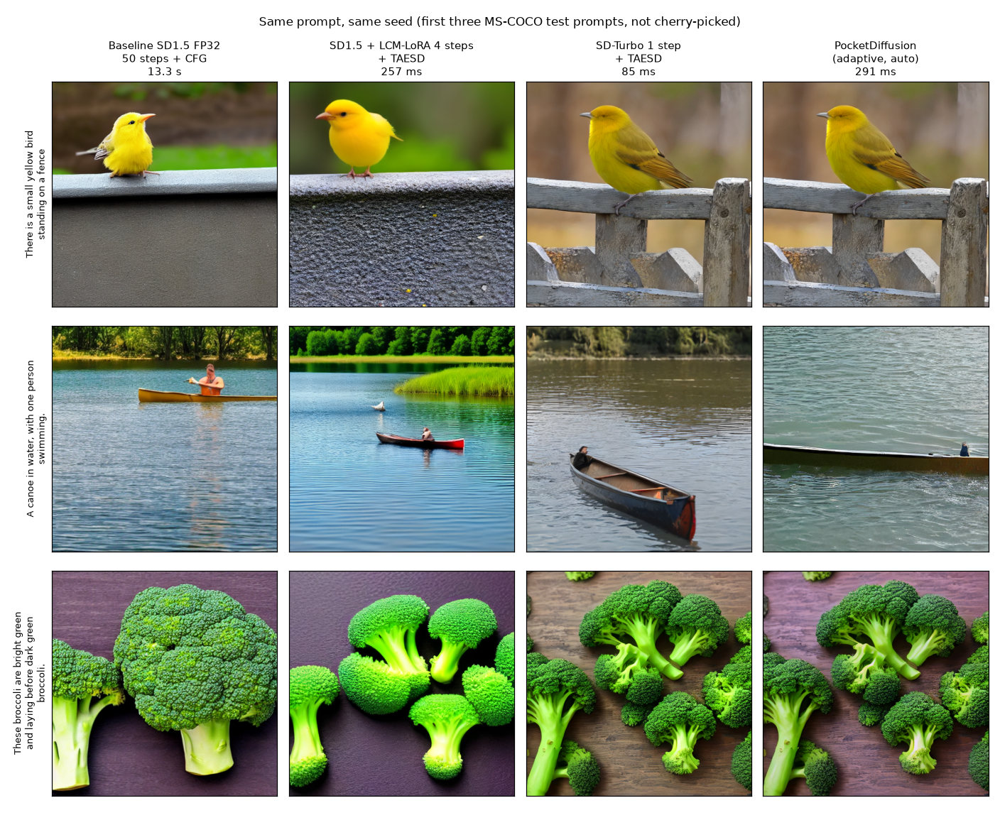
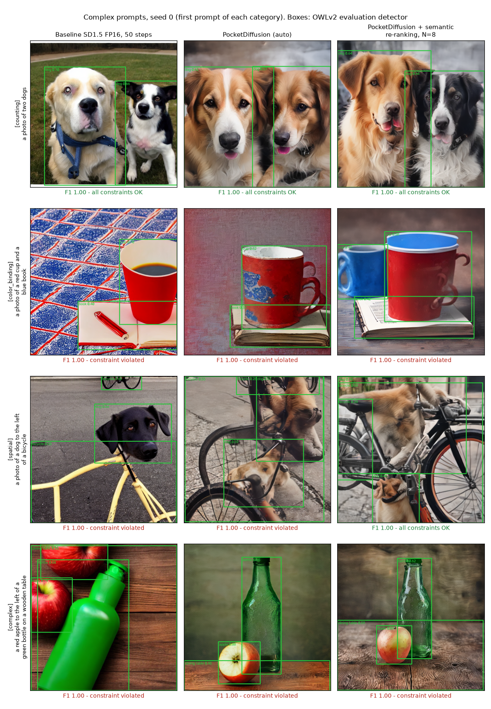
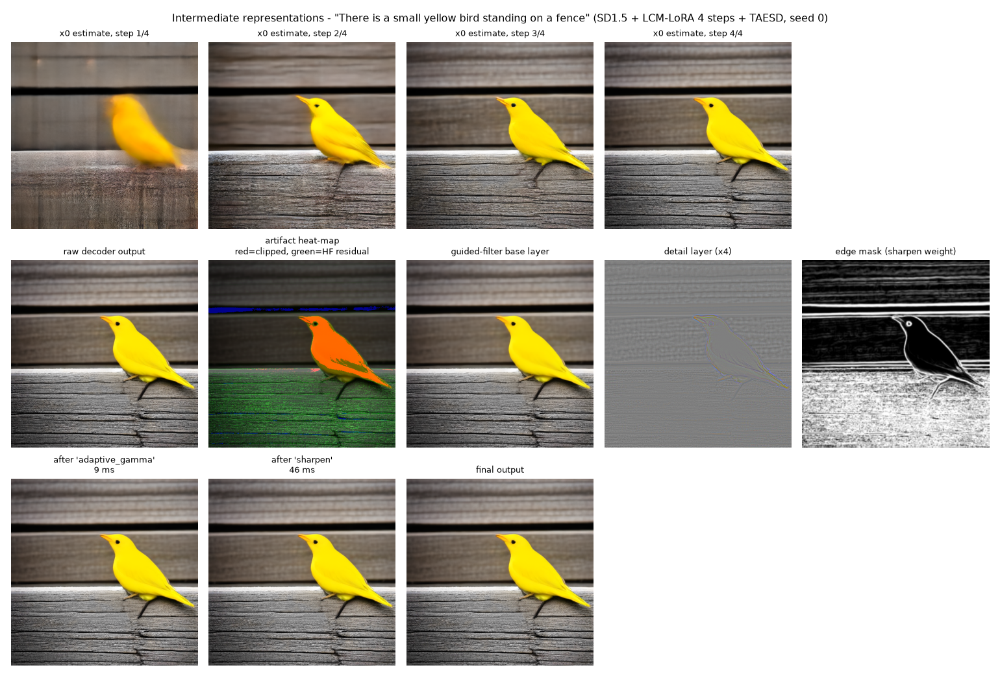

<!--
HOW TO FINISH THIS REPORT (delete this comment before submitting)
1. Every block between TEAM-TODO markers is a placeholder. Replace the whole block (markers included)
   with your own paragraph. The bullets are facts from our measurements to help you, not text to copy.
2. Blocks between AI-DRAFTED markers were drafted by Claude and are declared in section 6.
   Keep the markers while the text stays AI-written; if you rewrite a block yourself, remove its markers.
3. Fill every `[ ... ]` field in the header table.
4. Check the AI share and leftover placeholders before submitting:
       python scripts/ai_share.py Solution_Report_P3.md        (must say PASS, i.e. <= 30 %)
5. Every number below comes from eval_P3_<TeamID>.md / results/*.json (reproducible: python -m eval.run_all).
-->

# Hackathon Technical Solution Report

| Field | Details |
|---|---|
| **Problem ID** | P3 (Computer Vision Hackathon 2026) |
| **Problem Title** | Resource-Efficient Text-to-Image Generation for Mobile Devices |
| **Team Name** | `[Enter registered team name]` |
| **Team Members** | `[Full name – USN]`, `[Full name – USN]`, `[Full name – USN]`, `[Full name – USN]` |
| **GitHub Repository** | https://github.com/arpreran/pocketdiffusion, evaluated commit `f3ebe8d` (update to your final commit before submitting: `git rev-parse --short HEAD`) |
| **Live Demo / Deployment** | https://dc71bab2b6ac50c00b.gradio.live (full-stack web app: FastAPI + SQLite + web UI, served from an RTX 4060 laptop GPU) |

---

## 1. Problem Understanding & Solution Strategy

- **Core Technical Challenge:**

<!-- TEAM-TODO -->
> ✍️ **Team: write ~80–100 words in your own words.** Facts to cover:
> - Baseline Stable Diffusion v1.5: 1.07 B parameters, 4.07 GB of FP32 weights, 102 UNet evaluations per image (50 PNDM steps + 1, ×2 for classifier-free guidance), 84.5 TFLOPs per image → 13.3 s and 5.1 GB peak GPU memory on our RTX 4060 laptop. A phone has ~1–3 GB for one app and 0.3–4 TFLOPS.
> - Failure modes we target: (a) quality loss when steps / precision / resolution are cut (blur, 8-px grid, colour casts, clipping); (b) semantic failures on complex prompts (missing objects, wrong counts, colour leaking between objects, wrong left/right); (c) out-of-memory or missed deadline on weak devices.
> - Constraints: per-request latency budget (default 2 s), device memory budget (6.5 GB GPU down to 1.1 GB low-end phone), no public text-to-image API allowed.
<!-- /TEAM-TODO -->

- **Proposed Methodology:**

<!-- TEAM-TODO -->
> ✍️ **Team: write 2–3 sentences (the template asks for this length).** Facts to cover:
> - Not one compressed model but a budget-aware planner: per prompt it reads prompt complexity + device budget, enumerates ~700 configurations (model family × steps × resolution × decoder × precision × text encoder × number of candidates) and picks the best predicted quality that fits.
> - A custom denoising loop executes the plan (anytime output, deadline early-exit, out-of-memory fallback); classical CV screens, repairs and verifies the result.
> - Why not static: no single configuration is best for every prompt and device. Measured: adaptive auto mode beats the best static fast configuration on CLIP (26.72 vs 26.27) and FID (147.4 vs 150.3) while staying 86× faster than the baseline.
<!-- /TEAM-TODO -->

---

## 2. Technical Architecture & Implementation



### 2.1 Classical Algorithmic Baseline

- **Algorithms Utilized:**

<!-- TEAM-TODO -->
> ✍️ **Team: write ~80–100 words.** Facts (all implemented by us with NumPy/OpenCV primitives in `pocketdiff/classical/`):
> - Artifact detection (`artifacts.py`): blank/NaN, clipped highlights, crushed shadows, Lab colour-cast factor K, dynamic range, over-saturation, Immerkær noise σ, 8-px periodic grid (FFT peak score), Laplacian blur → severities in [0, 1].
> - Correction (`enhance.py`, `filters.py`): FFT notch filter for the grid, guided-filter (He et al.) edge-aware denoising, shades-of-grey white balance (p = 6), adaptive gamma, CLAHE on L*, saturation soft-knee, guided-filter base/detail sharpening with an edge mask (no halos).
> - Resolution (`resize.py`): snapping to multiples of 8 under a pixel budget (keeps the aspect ratio, e.g. 8K 16:9 → 680×384 native); iterative back-projection (IBP) super-resolution when the planner generates at 384 px.
> - Large outputs: "8K"/"4K" in a prompt are only style words for the model, so the app maps them to an output size reached classically: IBP super-resolution up to 4K + Lanczos to 8K (7680×4320 in ~2 s on the CPU). Diffusion runs at ~512 px only; the enlargement is sharper but adds no new detail.
> - Quality assessment (`iqa.py`): NIQE written from scratch (MSCN, GGD/AGGD fits, 36 features, MVG distance), pristine model fitted on 120 real COCO validation photos; PocketIQA composite score.
<!-- /TEAM-TODO -->

- **Adaptive Selection Logic:**

<!-- TEAM-TODO -->
> ✍️ **Team: write ~70–90 words.** Facts:
> - A stage runs only when its detector fires, and its strength scales with the measured severity: white-balance strength ∝ cast factor K, denoise radius/ε from σ_noise, gamma from mean luminance (target 0.46), CLAHE clip limit from dynamic range, notch filter only above the FFT grid-score threshold.
> - Thresholds were tuned on the validation split, never on the test split (example: the denoise threshold was raised after it worsened NIQE on validation).
> - Measured trigger rates on real outputs: sharpen 100 %, white balance 23 %, adaptive gamma 5 %, denoise 1 %, saturation knee 1 %, grid notch 0 %, CLAHE 0 %.
<!-- /TEAM-TODO -->

### 2.2 Deep Learning Pipeline

- **Model Architecture:**

<!-- TEAM-TODO -->
> ✍️ **Team: write ~90–110 words.** Facts:
> - Baseline: Stable Diffusion v1.5 (UNet 859.5 M, CLIP ViT-L text encoder 123.1 M, VAE decoder 83.7 M parameters).
> - Optimised families: SD1.5 + LCM-LoRA (latent consistency distillation; we fuse the LoRA into the weights, so it costs nothing at run time; 2–8 steps, no CFG) and SD-Turbo (adversarial diffusion distillation, 1 step).
> - TAESD tiny decoder: 2.45 M vs 83.7 M parameters, 14 ms vs 146 ms decode.
> - Our own weight-only quantisation: INT8 per output channel, INT4 in groups of 64 with two values per byte (relative weight error 1.1 % / 11.8 %).
> - Our own denoising loop (`pocketdiff/engine.py`), checked against the diffusers reference (`scripts/smoke_test.py`).
> - Prompt encoding for long prompts: CLIP reads only 77 tokens, so longer prompts are split into chunks of ≤ 75 tokens (cut at commas), each chunk is encoded separately and the embeddings are concatenated (77 → 154 → 231 tokens; up to 225 prompt tokens). The UNet cross-attention accepts the longer sequence; for CFG the negative prompt is padded to the same number of chunks. Prompts ≤ 75 tokens give exactly the same encoding as before (unit-tested).
> - Rationale: 98 % of the baseline time is the UNet (13,026 of 13,307 ms), so cutting UNet calls from 102 to 1–4 by distillation is the biggest lever.
> - Helper models (not generators): CLIP ViT-B/32 for re-ranking and the safety check, OWL-ViT v1 for semantic re-ranking; CLIP ViT-L/14 and OWLv2 are used **only for evaluation** (different models, so we never optimise the metric we report).
<!-- /TEAM-TODO -->

- **Loss Functions & Training:**

<!-- TEAM-TODO -->
> ✍️ **Team: write ~80–100 words.** Facts:
> - Trained by us: a 6-layer student text encoder (keeps layers 0, 2, 4, 7, 9, 11 of the 12-layer CLIP-L encoder; 123.1 M → 80.5 M parameters). Knowledge distillation loss = MSE + cosine on all 77 token hidden states. Trained on 400,171 MS-COCO *train* captions, early-stopped on *validation* captions: validation MSE 0.987 → 0.098, token cosine 0.950, 11.2 min on the RTX 4060. Effect on the test split: CLIP 25.23 → 25.21, 81 MB less memory.
> - Calibrated on data (no gradient training): the planner's quality model (CLIP change per configuration, measured on 100 validation prompts, with physical clamps) and the NIQE pristine model.
> - Pretrained and not retrained: SD1.5, LCM-LoRA, SD-Turbo, TAESD (original losses: noise-prediction MSE, consistency distillation, adversarial + distillation loss).
> - Data: MS-COCO 2014 Karpathy split (`yerevann/coco-karpathy` on Hugging Face; photos from `images.cocodataset.org`). Train → distillation, validation → calibration, test (200 prompts) → every reported number. No overlap between splits.
<!-- /TEAM-TODO -->

### 2.3 Hybrid Integration & Adaptive Mechanism

- **Fusion Strategy:**

<!-- TEAM-TODO -->
> ✍️ **Team: write ~80–100 words.** Facts: classical CV is used at four points of the neural pipeline:
> 1. Before generation: rule-based prompt parser builds a scene graph (objects, counts, colours, relations; agreement with our annotations: objects 1.00, counts 1.00, colours 0.99, relations 1.00) → prompt complexity for the planner.
> 2. Right after denoising: cheap artifact screening of every candidate (blank / NaN / exposure / cast) → bad candidates are dropped or regenerated.
> 3. Selection: score = CLIP-B/32 + per-object coverage + 0.05·(PocketIQA − 50) − 2·artifact severity.
> 4. After selection: severity-driven post-processing + IBP upscaling, then verification with OWLv2 boxes + HSV colour statistics + box geometry.
> - The artifact heat-map and the x0 estimate after every denoising step are shown in the UI (Figure 3).
<!-- /TEAM-TODO -->

- **Decision Logic:**

<!-- TEAM-TODO -->
> ✍️ **Team: write ~90–110 words.** Facts:
> - Utility = predicted CLIP − λ·log2(latency / 100 ms), with λ = 1.0 − 0.7·c (c = prompt complexity, 0…1): simple prompts get the cheapest plan, complex prompts are allowed more compute.
> - Predicted re-ranking gain grows with the number of checkable constraints (objects + colours + counts + relations), so multi-object prompts get 4 candidates.
> - Latency predicted from a measured UNet time table (resolution × batch) + decode + post-processing; memory = weights × bytes per precision + measured activations.
> - Hard limits: the plan must fit both budgets; if nothing fits → fastest plan that fits memory. At run time: deadline early-exit returns the current x0 estimate instead of failing; out-of-memory → fewer candidates → 384 px → TAESD → INT8 → 256 px → CPU.
> - Planner decisions per device (eval file §8): this GPU → SD-Turbo 512 px, N = 4; flagship phone → SD-Turbo 384 px INT8; low-end phone → SD1.5 + LCM 2 steps, 256 px, INT8, 6-layer text encoder (1,090 MB predicted).
<!-- /TEAM-TODO -->

---

## 3. Experimental Benchmarks & Evaluation

### 3.1 Quantitative Benchmarks

<!-- AI-DRAFTED -->
PSNR and SSIM need a ground-truth image, which a text prompt does not have, so we report the P3 metrics instead. No classical image generator exists, so row 1 is the unoptimised neural baseline. Same 200 unseen MS-COCO test prompts and seeds for every row; object F1 from our 58-prompt compositional benchmark.
<!-- /AI-DRAFTED -->

| Approach / Model Variant | CLIP ↑ | FID ↓ | NIQE ↓ | Artifact rate ↓ | Object F1 ↑ | Latency (ms / image) | Peak GPU memory |
|---|---|---|---|---|---|---|---|
| **Unoptimised baseline**: SD1.5 FP32, PNDM 50 steps, CFG 7.5 | 26.43 | 150.8 | 4.19 | 0.30 | 0.889 ¹ | 13,307 | 5,065 MB |
| **Deep learning only**: SD-Turbo 1 step + TAESD (static, no classical stages, no planner) | 26.27 | 150.3 | 3.81 | 0.20 | 0.940 | 85 | 2,489 MB |
| **Proposed hybrid system**: PocketDiffusion (adaptive, auto mode) | **26.72** | **147.4** | **3.74** | **0.07** | **0.958** | 155 (generation) / 291 (end-to-end) | 3,039 MB |

<!-- AI-DRAFTED -->
¹ SD1.5 FP16, 50 steps (same model at half precision).
<!-- /AI-DRAFTED -->

#### Optimisation ladder (512×512, batch 1, after warm-up)

| Configuration | UNet evals | Latency ms | Speed-up | Peak MB | Weights MB | CLIP |
|---|---|---|---|---|---|---|
| Baseline SD1.5 FP32, PNDM-50, CFG | 102 | 13,307 | 1.0× | 5,065 | 4,067 | 26.43 |
| + FP16 | 102 | 5,170 | 2.6× | 2,676 | 2,034 | 26.38 |
| + DPM-Solver++ 20 steps | 40 | 2,120 | 6.3× | 2,676 | 2,034 | 26.53 |
| + LCM-LoRA 4 steps (distilled) | 4 | 388 | 34.3× | 2,675 | 2,034 | 25.24 |
| + TAESD decoder | 4 | 257 | 51.7× | 2,068 | 1,879 | 25.27 |
| + INT8 weights | 4 | 366 | 36.4× | 1,246 | 1,062 | 25.23 |
| + distilled 6-layer text encoder | 4 | 360 | 37.0× | 1,162 | 981 | 25.21 |
| SD-Turbo 1 step + TAESD | 1 | 85 | 156× | 2,489 | 2,305 | 26.27 |
| SD-Turbo 1 step + TAESD + INT8 | 1 | 104 | 128× | 1,671 | 1,483 | 26.28 |
| SD1.5 LCM 4 steps + TAESD + INT4 (validation split) | 4 | 558 | 24× | – | 678 | 24.67 |
| CPU only: LCM 2 steps, 256 px, TAESD, FP32 | 2 | 1,514 | 8.8× | 4,286 (RAM) | 1,879 | – |

| Full result tables (KID, model size, TFLOPs, device plans, degradation curves) |
|---|
| [`eval_P3_TXX.md`](eval_P3_TXX.md) |

- **Analysis:**

<!-- TEAM-TODO -->
> ✍️ **Team: write 2–3 sentences** about the trade-offs. Facts to use:
> - Speed: 13.3 s → 155 ms generation (86×); the biggest single gain is distillation (102 → 4 or 1 UNet calls), FP16 gives 2.6×, TAESD removes ~130 ms of decoding.
> - Memory: INT8 saves 40 % of peak memory but is *slower* on the GPU (366 vs 257 ms: weights are de-quantised on the fly, no INT8 kernels), so the planner uses it only when memory forces it.
> - Quality: LCM 4 steps costs −1.2 CLIP; SD-Turbo costs almost nothing (−0.16); the hybrid system gets the best CLIP, FID, NIQE and artifact rate of all rows because re-ranking + classical repair recover quality. Price: 291 ms end-to-end vs 85 ms for the bare model.
<!-- /TEAM-TODO -->

### 3.2 Visual Outputs & Intermediate Representations

#### 1. Baseline vs optimised output



<!-- AI-DRAFTED -->
*Figure 1.* First three MS-COCO test prompts (not cherry-picked), same seed for every system; titles give the measured mean latency.
<!-- /AI-DRAFTED -->

#### 2. Complex prompts: objects, counts, colours, positions



<!-- AI-DRAFTED -->
*Figure 2.* First prompt of four hard categories. Boxes: OWLv2 evaluation detector. Below each image: object F1 and whether every count, colour and position constraint holds (red = failure, see section 4).
<!-- /AI-DRAFTED -->

#### 3. Intermediate states



<!-- AI-DRAFTED -->
*Figure 3.* Top: x0 estimate after each denoising step (streamed live in the app). Middle: raw output, artifact heat-map, guided-filter base and detail layers, sharpening edge mask. Bottom: output of each post-processing stage that fired, with its cost.
<!-- /AI-DRAFTED -->

#### Further plots

| [quality vs latency](results/plots/quality_vs_latency.png) | [latency / memory breakdown](results/plots/latency_memory_breakdown.png) | [degradation curves](results/plots/degradation.png) | [compositional accuracy](results/plots/compositional.png) | [text-encoder distillation](results/plots/text_encoder_distillation.png) |
|---|---|---|---|---|

### 3.3 Ablation Study

#### A. Removing one component at a time (100 test prompts)

| Variant | CLIP-L ↑ | NIQE ↓ | Artifact rate ↓ | Latency ms |
|---|---|---|---|---|
| Full system | 26.71 | 3.85 | 0.07 | 305 |
| − best-of-N re-ranking | 26.36 | 3.75 | 0.12 | 169 |
| − classical post-processing | 26.75 | 3.87 | 0.21 | 236 |
| − prompt-complexity adaptation (fixed λ) | 26.38 | 3.77 | 0.09 | 219 |
| − planner (one fixed configuration) | 26.14 | 3.74 | 0.10 | 154 |

#### B. Classical post-processing stages (leave-one-out)

| Variant | CLIP-L ↑ | NIQE ↓ | Artifact rate ↓ | ms / image |
|---|---|---|---|---|
| No post-processing | 26.11 | 3.78 | 0.24 | 0 |
| All stages (adaptive) | 26.16 | 3.74 | 0.10 | 94 |
| All − white balance | 26.16 | 3.74 | 0.21 | 98 |
| All − edge-aware sharpening | 26.11 | 3.78 | 0.12 | 59 |
| All − denoise | 26.16 | 3.74 | 0.11 | 96 |

#### C. Resolution optimisation (generate 384 px, upscale to 512 px)

| Variant | CLIP-L ↑ | NIQE ↓ | Generation ms | Upscale ms |
|---|---|---|---|---|
| Native 512 px | 26.11 | 3.78 | 76 | – |
| 384 → 512 nearest | 26.10 | 6.65 | 54 | 1.8 |
| 384 → 512 bicubic | 26.10 | 5.00 | 54 | 2.3 |
| 384 → 512 Lanczos | 26.07 | 4.98 | 54 | 2.6 |
| 384 → 512 **IBP (ours)** | 26.32 | **3.83** | 54 | 54.0 |

#### D. Semantic re-ranking (58 compositional prompts × 2 seeds)

| System | Object F1 ↑ | All constraints ↑ | Count acc | Colour acc | Spatial acc | ms / image |
|---|---|---|---|---|---|---|
| Baseline SD1.5 FP16, 50 steps | 0.889 | 0.53 | 0.42 | 0.61 | 0.41 | 5,195 |
| PocketDiffusion (auto) | 0.958 | 0.59 | 0.38 | 0.64 | 0.55 | 312 |
| + semantic re-ranking, N = 4 | 0.956 | 0.66 | 0.42 | 0.70 | 0.66 | 485 |
| + semantic re-ranking, N = 8 | 0.959 | 0.77 | 0.50 | 0.79 | 0.77 | 877 |

<!-- TEAM-TODO -->
> ✍️ **Team: write ~90–120 words** interpreting the ablation. Points to explain:
> - The planner gives the largest CLIP gain (+0.57 over one fixed configuration); re-ranking adds +0.35 but costs 136 ms (305 vs 169 ms); complexity adaptation adds +0.33.
> - Post-processing does not change CLIP (it is not supposed to) but cuts the artifact rate 3× (0.21 → 0.07); white balance does most of that work.
> - Honest observation: removing re-ranking gives a *lower* (better) NIQE (3.75 vs 3.85): CLIP prefers detailed, high-contrast candidates that NIQE scores as less natural.
> - IBP upscaling makes 384 px generation look like native 512 px (NIQE 3.83 vs 3.78) while saving 22 ms of GPU time, but IBP itself costs 54 ms on the CPU.
> - Object F1 saturates at ~0.96; the stricter all-constraints rate keeps improving with more candidates.
<!-- /TEAM-TODO -->

---

## 4. Failure Modes & Limitations

| # | Category | Prompt / setting | What went wrong (measured) | Evidence |
|---|---|---|---|---|
| F1 | Counting | "a photo of three apples" | 4 apples (seed 0) and 5 apples (seed 1) | [image](results/failures/pocketdiff_c02_s0.png) |
| F2 | Attribute binding | "a photo of a red cup and a blue book" | the blue went onto the cup's pattern; the book is beige (both seeds) | [image](results/failures/pocketdiff_k09_s0.png) |
| F3 | Spatial relations | "a red apple to the left of a green bottle on a wooden table" | relation violated by all three systems in Figure 2; *complex* category all-constraints rate 0 % (auto) → 30 % (N = 8) | Figure 2, row 4 |
| F4 | Compression | 50 % magnitude pruning of the SD1.5 UNet; SD1.5 at 256 px | CLIP 25.23 → 13.76 (pruning); 25.23 → 15.22 (256 px) | [degradation plot](results/plots/degradation.png) |
| F5 | Evaluation error | "a photo of a red car" | a red car is clearly visible (cropped at the border) but OWLv2 missed it, so it is counted as a missing object | [image](results/failures/pocketdiff_k01_s0.png) |

- **Observed Failure Case + Root Cause & Mitigation:**

<!-- TEAM-TODO -->
> ✍️ **Team: for at least three of the rows above write ~50–70 words each: the technical cause and a fix.** Facts:
> - F1: the CLIP text encoder has almost no notion of number ("three" ≈ "some"), and 1-step models cannot correct the object layout later. Mitigation: count-aware re-ranking with a detector (counting all-constraints 50 % → 63 % with N = 8), layout / box-guided generation (GLIGEN-style).
> - F2: cross-attention gets a single text embedding in which adjectives leak between nouns ("red" and "blue" are mixed). Mitigation: Attend-and-Excite style attention guidance, regional prompts per object, semantic re-ranking (colour-binding 25 % → 50 % with N = 8).
> - F3: conditioning is close to a bag of words; "left of" barely changes the embedding. Mitigation: layout planning + box conditioning; semantic re-ranking (spatial 45 % → 85 % with N = 8).
> - F4: unstructured pruning without fine-tuning removes weights the network relies on and gives no speed-up on dense GPUs; SD1.5 was trained at 512 px, so a 32×32 latent is out of distribution. Mitigation: structured pruning + distillation (BK-SDM), the planner never uses pruning and prefers SD-Turbo when it must go to 256 px (CLIP 24.44).
> - F5: detector-based metrics inherit detector errors; about half of the remaining misses are evaluator errors. Mitigation: calibrate the detector threshold on real COCO photos with ground-truth boxes (separate data, never the test results).
<!-- /TEAM-TODO -->

- **Limitations:**

<!-- TEAM-TODO -->
> ✍️ **Team: write ~50–70 words.** Facts: phone latencies are estimates (measured FLOPs ÷ assumed throughput), not on-device measurements; FID on 200 images is biased upwards (compare rows only; KID reported as unbiased); NIQE pristine model is COCO-fitted, not comparable to MATLAB NIQE; the zero-shot safety check is coarse; INT8/INT4 save memory but not GPU time without integer kernels.
<!-- /TEAM-TODO -->

---

## 5. Deployment & Quickstart Guide

**Quickstart Commands**

```bash
# 1. Clone the repository and install dependencies (Python 3.11, NVIDIA GPU recommended)
git clone <your-github-repo-url>
cd pocketdiffusion
python -m venv .venv
.venv\Scripts\activate                     # Linux/macOS: source .venv/bin/activate
pip install torch torchvision --index-url https://download.pytorch.org/whl/cu126
pip install -r requirements.txt
python scripts/download_assets.py --core   # public pretrained weights, no token needed

# 2. Run inference on a file of prompts (one per line) -> images + log.json
python generate.py --prompts prompts/samples.txt --out outputs/
python generate.py --prompts prompts/samples.txt --device lowend_phone --out outputs_lowend/

# 3. Full-stack web app (http://127.0.0.1:8000); --share also prints a public link
python serve.py --share

# 4. Reproduce every number in this report (~2-3 h on an RTX 4060 laptop)
python -m eval.run_all
```

**Deployment Format**

<!-- AI-DRAFTED -->
PocketDiffusion is a full-stack web application. A FastAPI backend (`backend/`) runs every generation on a single GPU worker thread with a job queue and streams progress (plan, denoising previews, post-processing stages) to the browser over Server-Sent Events. Every generation is stored in SQLite with its plan and timings. The web UI (`frontend/`) has Studio, Gallery, Lab (live charts), Race (baseline vs optimised) and About pages. The live link is served from our laptop GPU through Gradio's share tunnel (`python serve.py --share`). A Dockerfile, an alternative Gradio interface (`app.py`) and the command-line tool (`generate.py`) are also provided.
<!-- /AI-DRAFTED -->

---

## 6. AI-Assistance Declaration

<!-- AI-DRAFTED -->
**Tool:** Claude (Anthropic), used as an AI coding assistant in the development environment.
**System design and code:** the assistant took part in system design discussions and wrote most of the source code (`pocketdiff/`, `backend/`, `frontend/`, `eval/`, `scripts/`). It also wrote the 58 prompts of the compositional benchmark (`prompts/compositional.json`).
**Results:** every number comes from the evaluation scripts in `eval/`, run on our hardware; none were typed in by hand.
**This report:** the text inside AI-drafted blocks (the note in 3.1, the three figure captions, the deployment format and this declaration) was drafted by the assistant. Tables were generated from `results/*.json`. All other text was written by the team.
<!-- /AI-DRAFTED -->

<!-- TEAM-TODO -->
> ✍️ **Team: write what you did yourselves (~50–80 words, honest)**: who reviewed and can explain which modules (see `docs/VIVA_GUIDE.md` for the split), which experiments you ran, which decisions you made, what you changed. Then add one line: "Measured AI share of the report text: __ %" (from `python scripts/ai_share.py Solution_Report_P3.md`).
<!-- /TEAM-TODO -->

---

## Student Submission Checklist

- [ ] Working GitHub repository link included with an updated `README.md`.
- [ ] No raw code pasted into this report.
- [ ] All table metrics match test runs reproducible via the repository (`python -m eval.run_all`).
- [ ] All team member details accurately recorded (`team.json` filled, then `python -m eval.make_report` re-run).
- [ ] Live demo link tested from a phone on mobile data.
- [ ] `python scripts/ai_share.py Solution_Report_P3.md` reports PASS (≤ 30 % AI text, no placeholders left).
