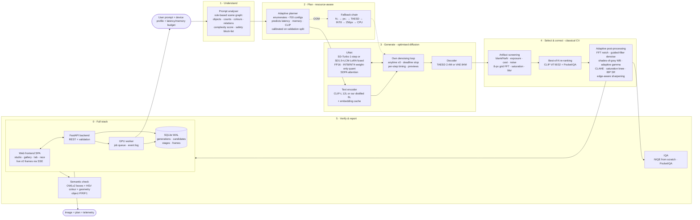

# PocketDiffusion – system architecture

| Stage | Module | Classical / DL | Key idea |
|---|---|---|---|
| Frontend | `frontend/` (HTML/CSS/JS) | – | framework-free SPA: live denoising stream, planner preview, before/after, detections overlay, gallery, SVG charts, race |
| Backend | `backend/main.py`, `backend/jobs.py` | – | FastAPI REST + Server-Sent Events; one GPU worker thread owns the model |
| Database | `backend/db.py` | – | SQLite (WAL): every generation, candidate, post-processing stage and denoising frame |
| Prompt analysis | `pocketdiff/prompt_analyzer.py` | classical (rules) | scene graph + complexity drives planning and verification |
| Planner | `pocketdiff/planner.py` | data-driven model | maximise predicted CLIP − λ·log(latency) s.t. latency & memory budgets |
| Engine | `pocketdiff/engine.py` | DL | own sampling loop, anytime output, model cache, OOM fallback |
| Compression | `pocketdiff/optimizations.py` | DL | FP16, INT8/INT4 weight-only quantisation, magnitude pruning, LoRA fusion |
| Distillation | `scripts/distill_text_encoder.py` | DL (training) | 12→6-layer text encoder, COCO train/val split |
| Artifacts | `pocketdiff/classical/artifacts.py` | classical | severities, not booleans, so corrections scale with the problem |
| Post-processing | `pocketdiff/classical/postprocess.py` | classical | guided filter, WB, gamma, CLAHE, FFT notch, IBP super-resolution |
| IQA | `pocketdiff/classical/iqa.py` | classical | NIQE (MSCN + AGGD + MVG) from scratch, PocketIQA composite |
| Re-ranking / safety | `pocketdiff/scoring.py` | DL | CLIP-B/32 in the loop, CLIP-L/14 only for evaluation |
| Verification | `pocketdiff/verifier.py` | hybrid | OWLv2 detection + HSV colour naming + box geometry |
| App | `app.py` | – | Gradio UI with loading/error states, trajectory and stage visualisations |
