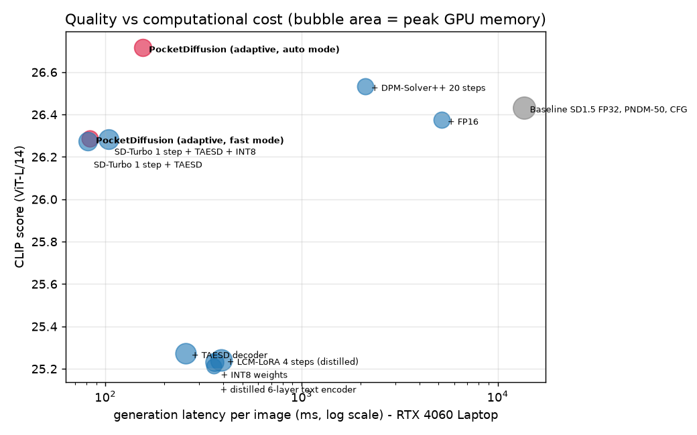
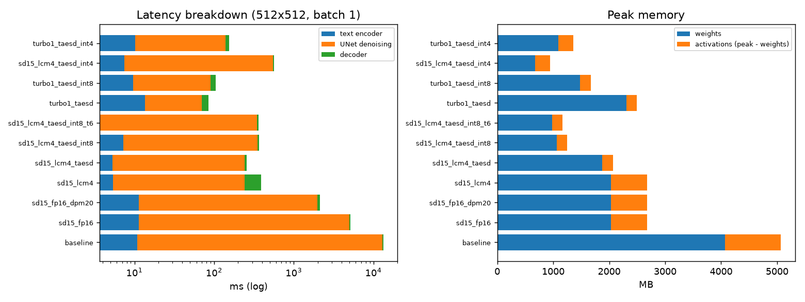
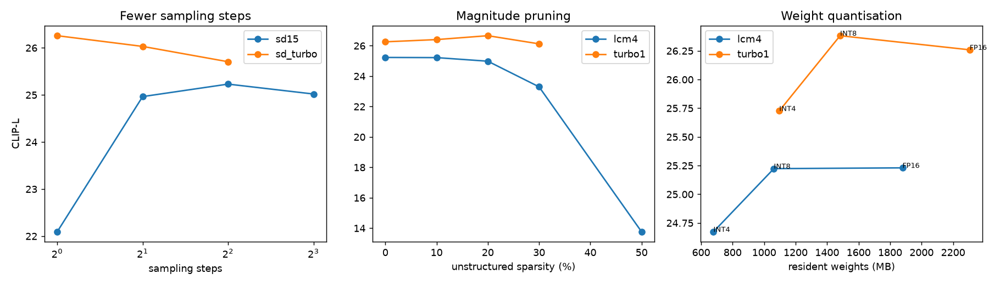
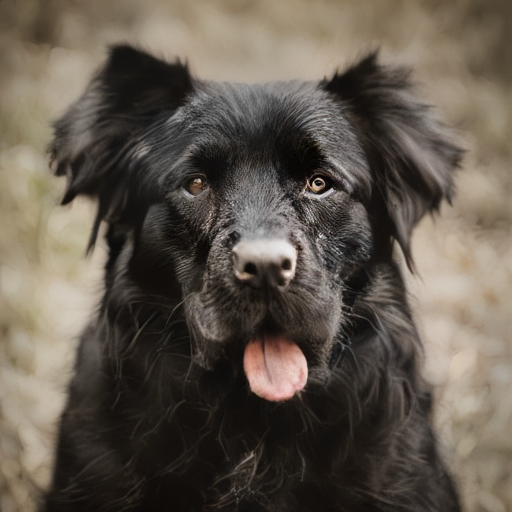

1RUA24CSE0332,1RUA24CSE0341,1RUA24CSE0373

# Evaluation – P3 Resource-Efficient Text-to-Image Generation (Team 33)

Hardware: NVIDIA GeForce RTX 4060 Laptop GPU · PyTorch 2.14.1+cu126 · measured 2026-11-06 20:08.  
Test set: 200 unseen MS-COCO (Karpathy *test*) captions, one image per prompt, identical seeds for every system. Planner calibrated on the separate *validation* split.

## 1. CLIP similarity (text-image alignment, ViT-L/14, higher is better)

| system | CLIP score (mean ± s.e.) | Δ vs baseline |
|---|---|---|
| Baseline SD1.5 FP32, PNDM-50, CFG | 26.43 ± 0.22 | 0.00 |
| + FP16 | 26.38 ± 0.23 | -0.06 |
| + DPM-Solver++ 20 steps | 26.53 ± 0.22 | 0.10 |
| + LCM-LoRA 4 steps (distilled) | 25.24 ± 0.22 | -1.19 |
| + TAESD decoder | 25.27 ± 0.21 | -1.16 |
| + INT8 weights | 25.23 ± 0.22 | -1.20 |
| + distilled 6-layer text encoder | 25.21 ± 0.23 | -1.22 |
| SD-Turbo 1 step + TAESD | 26.27 ± 0.21 | -0.16 |
| SD-Turbo 1 step + TAESD + INT8 | 26.28 ± 0.21 | -0.15 |
| **PocketDiffusion (adaptive, auto mode)** | 26.72 ± 0.21 | 0.28 |
| **PocketDiffusion (adaptive, fast mode)** | 26.29 ± 0.21 | -0.15 |
| *Real COCO photos (reference)* | 25.18 | – |

## 2. FID / KID (distribution-level realism vs real COCO images, lower is better)

FID on a few hundred images is biased upwards (it is only comparable *between* rows of this table); KID is unbiased at small N and is reported alongside.

| system | FID | KID ×10³ |
|---|---|---|
| Baseline SD1.5 FP32, PNDM-50, CFG | 150.8 | 3.94 ± 1.82 |
| + FP16 | 151.2 | 3.65 ± 1.28 |
| + DPM-Solver++ 20 steps | 151.4 | 3.07 ± 1.56 |
| + LCM-LoRA 4 steps (distilled) | 157.4 | 8.73 ± 1.61 |
| + TAESD decoder | 158.2 | 8.64 ± 1.59 |
| + INT8 weights | 156.8 | 8.86 ± 1.66 |
| + distilled 6-layer text encoder | 157.0 | 8.25 ± 1.61 |
| SD-Turbo 1 step + TAESD | 150.3 | 5.93 ± 2.20 |
| SD-Turbo 1 step + TAESD + INT8 | 150.7 | 6.72 ± 2.75 |
| **PocketDiffusion (adaptive, auto mode)** | 147.4 | 3.80 ± 1.94 |
| **PocketDiffusion (adaptive, fast mode)** | 147.3 | 3.35 ± 1.73 |

No-reference perceptual quality on the same test images (`python -m eval.eval_iqa_test`). NIQE uses our COCO-fitted pristine model; artifact rate = share of images with at least one artifact flag from the classical detector.

| system | NIQE ↓ | PocketIQA ↑ | artifact rate ↓ |
|---|---|---|---|
| Baseline SD1.5 FP32, PNDM-50, CFG | 4.19 | 87.6 | 0.30 |
| + DPM-Solver++ 20 steps | 4.22 | 87.4 | 0.32 |
| + TAESD decoder | 5.02 | 87.3 | 0.45 |
| SD-Turbo 1 step + TAESD | 3.81 | 87.2 | 0.20 |
| **PocketDiffusion (adaptive, auto mode)** | 3.74 | 87.7 | 0.07 |
| **PocketDiffusion (adaptive, fast mode)** | 3.76 | 88.1 | 0.18 |

## 3. Image generation latency (512×512, batch 1, after warm-up)

| system | UNet evals | latency ms | text ms | UNet ms | decode ms | speed-up |
|---|---|---|---|---|---|---|
| Baseline SD1.5 FP32, PNDM-50, CFG | 102 | 13307 ± 7 | 10.9 | 13026 | 270.2 | 1.0× |
| + FP16 | 102 | 5170 ± 4 | 11.4 | 5013 | 145.7 | 2.6× |
| + DPM-Solver++ 20 steps | 40 | 2120 ± 4 | 11.4 | 1962 | 146.1 | 6.3× |
| + LCM-LoRA 4 steps (distilled) | 4 | 388 ± 2 | 5.4 | 237 | 145.5 | 34.3× |
| + TAESD decoder | 4 | 257 ± 1 | 5.3 | 238 | 14.1 | 51.7× |
| + INT8 weights | 4 | 366 ± 5 | 7.2 | 344 | 14.7 | 36.4× |
| + distilled 6-layer text encoder | 4 | 360 ± 3 | 3.7 | 342 | 14.2 | 37.0× |
| SD-Turbo 1 step + TAESD | 1 | 85 ± 8 | 13.6 | 56 | 15.3 | 156.4× |
| SD-Turbo 1 step + TAESD + INT8 | 1 | 104 ± 2 | 9.7 | 81 | 14.2 | 127.5× |
| **PocketDiffusion (adaptive, auto mode)** | adaptive | 155 (gen) / 291 (end-to-end) | – | – | – | 85.7× |
| **PocketDiffusion (adaptive, fast mode)** | adaptive | 83 (gen) / 164 (end-to-end) | – | – | – | 159.6× |

CPU-only fallback (constrained-device proxy, 10 threads):

| config | latency ms | peak RSS MB |
|---|---|---|
| CPU fallback 256px, LCM 2 steps, TAESD, FP32 | 1514 | 4286 |
| CPU fallback 384px, LCM 2 steps, TAESD, FP32 | 2708 | 4341 |

## 4. Peak memory consumption (CUDA allocator peak during one generation)

| system | peak MB | weights MB | activations MB | reduction |
|---|---|---|---|---|
| Baseline SD1.5 FP32, PNDM-50, CFG | 5065 | 4067 | 998 | 1.0× |
| + FP16 | 2676 | 2034 | 642 | 1.9× |
| + DPM-Solver++ 20 steps | 2676 | 2034 | 642 | 1.9× |
| + LCM-LoRA 4 steps (distilled) | 2675 | 2034 | 641 | 1.9× |
| + TAESD decoder | 2068 | 1879 | 189 | 2.4× |
| + INT8 weights | 1246 | 1062 | 184 | 4.1× |
| + distilled 6-layer text encoder | 1162 | 981 | 181 | 4.4× |
| SD-Turbo 1 step + TAESD | 2489 | 2305 | 183 | 2.0× |
| SD-Turbo 1 step + TAESD + INT8 | 1671 | 1483 | 188 | 3.0× |

## 5. Model size

| system | UNet M params | text-enc M | decoder M | total M | size MB | compression |
|---|---|---|---|---|---|---|
| Baseline SD1.5 FP32, PNDM-50, CFG | 859.5 | 123.1 | 83.65 | 1066.2 | 4067 | 1.0× |
| + FP16 | 859.5 | 123.1 | 83.65 | 1066.2 | 2034 | 2.0× |
| + DPM-Solver++ 20 steps | 859.5 | 123.1 | 83.65 | 1066.2 | 2034 | 2.0× |
| + LCM-LoRA 4 steps (distilled) | 859.5 | 123.1 | 83.65 | 1066.2 | 2034 | 2.0× |
| + TAESD decoder | 859.5 | 123.1 | 2.45 | 985.0 | 1879 | 2.2× |
| + INT8 weights | 859.5 | 123.1 | 2.45 | 985.0 | 1062 | 3.8× |
| + distilled 6-layer text encoder | 859.5 | 80.5 | 2.45 | 942.5 | 981 | 4.1× |
| SD-Turbo 1 step + TAESD | 865.9 | 340.4 | 2.45 | 1208.7 | 2305 | 1.8× |
| SD-Turbo 1 step + TAESD + INT8 | 865.9 | 340.4 | 2.45 | 1208.7 | 1483 | 2.7× |
| + INT4 weights | 859.5 | 123.1 | 2.45 | 985.0 | 678 | 6.0× |
| SD-Turbo 1 step + TAESD + INT4 | 865.9 | 340.4 | 2.45 | 1208.7 | 1096 | 3.7× |

## 6. Quality versus computational cost

| system | TFLOPs / image | latency ms | peak MB | CLIP | FID | CLIP per TFLOP |
|---|---|---|---|---|---|---|
| Baseline SD1.5 FP32, PNDM-50, CFG | 84.48 | 13307 | 5065 | 26.43 | 150.8 | 0.31 |
| + FP16 | 84.48 | 5170 | 2676 | 26.38 | 151.2 | 0.31 |
| + DPM-Solver++ 20 steps | 34.67 | 2120 | 2676 | 26.53 | 151.4 | 0.77 |
| + LCM-LoRA 4 steps (distilled) | 5.74 | 388 | 2675 | 25.24 | 157.4 | 4.40 |
| + TAESD decoder | 3.37 | 257 | 2068 | 25.27 | 158.2 | 7.50 |
| + INT8 weights | 3.37 | 366 | 1246 | 25.23 | 156.8 | 7.49 |
| + distilled 6-layer text encoder | 3.36 | 360 | 1162 | 25.21 | 157.0 | 7.50 |
| SD-Turbo 1 step + TAESD | 0.99 | 85 | 2489 | 26.27 | 150.3 | 26.52 |
| SD-Turbo 1 step + TAESD + INT8 | 0.99 | 104 | 1671 | 26.28 | 150.7 | 26.53 |

## 7. Semantic consistency on complex prompts (multiple objects, attributes, spatial relations)

58 annotated prompts (written with AI assistance) × seeds. OWLv2 detects requested objects plus 6 distractor classes (false positives); colours are verified with HSV statistics inside the detected box and relations geometrically from box centres. Object-level F1 is micro-averaged.

| system | precision | recall | **object F1** | count acc | colour acc | spatial acc | all constraints | CLIP | ms / image |
|---|---|---|---|---|---|---|---|---|---|
| Baseline SD1.5 FP16, 50 steps, CFG | 0.971 | 0.820 | 0.889 | 0.42 | 0.61 | 0.41 | 0.53 | 26.72 | 5195 |
| SD1.5 DPM-Solver++ 20 steps | 0.957 | 0.859 | 0.905 | 0.46 | 0.57 | 0.48 | 0.54 | 26.75 | 2138 |
| SD1.5 + LCM 4 steps + TAESD | 0.970 | 0.772 | 0.859 | 0.42 | 0.57 | 0.36 | 0.51 | 26.02 | 283 |
| SD-Turbo 1 step + TAESD | 0.964 | 0.917 | 0.940 | 0.33 | 0.64 | 0.57 | 0.59 | 27.25 | 106 |
| **PocketDiffusion (auto)** | 0.980 | 0.937 | 0.958 | 0.38 | 0.64 | 0.55 | 0.59 | 27.64 | 312 |
| PocketDiffusion + semantic re-ranking, N=4 ‡ | 0.970 | 0.942 | 0.956 | 0.42 | 0.70 | 0.66 | 0.66 | 27.56 | 485 |
| PocketDiffusion + semantic re-ranking, N=8 ‡ | 0.957 | 0.961 | 0.959 | 0.50 | 0.79 | 0.77 | 0.77 | 27.90 | 877 |

‡ Semantic re-ranking picks the candidate that best satisfies the prompt according to **OWL-ViT v1** (selection detector); this table is scored by **OWLv2** (evaluation detector) - different weights, so the system never optimises the exact evaluator, although both belong to the same model family. Object F1 saturates at ~0.96: about half of the remaining misses are evaluator errors (objects that are visibly present, e.g. a cropped car or a small cyclist, are not detected) and the rest are attribute-binding failures of the diffusion model ("black cat and white dog" -> two black-and-white dogs). The stricter *all constraints* metric keeps improving with more candidates.

Rule-based prompt parser vs annotations: object recall 1.00, count 1.00, colour 0.99, relation recall 1.00.

## 8. Resource requirements for mobile deployment targets

Latency for phone profiles = measured FLOPs ÷ an *assumed* effective throughput (stated per profile); these are estimates, not on-device measurements. Memory = weights at the chosen precision + measured activations.

| device profile | memory budget MB | assumed TFLOPS | plan chosen by planner | pred. MB | pred. ms | status |
|---|---|---|---|---|---|---|
| This machine (GPU, measured) | 6500 | – | sd_turbo euler-1 @512px, none, taesd, TE=full, N=4 | 3476 | 501 | fits |
| Flagship phone NPU (simulated) | 3000 | 4.0 | sd_turbo euler-1 @384px, int8, taesd, TE=full, N=4 | 2297 | 533 | fits |
| Mid-range phone (simulated) | 1800 | 1.2 | sd_turbo euler-1 @384px, int8, taesd, TE=full, N=1 | 1675 | 448 | fits |
| Low-end phone (simulated) | 1100 | 0.3 | sd15 lcm-2 @256px, int8, taesd, TE=t6, N=1 | 1090 | 1477 | fits |
| This machine (CPU only, measured) | 6000 | – | sd_turbo euler-1 @384px, none, taesd, TE=full, N=1 | 2524 | 2791 | fits |

## 9. Quality degradation from compression / fewer steps (validation split)

| run | group | family | steps | px | weights | sparsity | TE | decoder | N | CLIP-L | gen ms | weights MB |
|---|---|---|---|---|---|---|---|---|---|---|---|---|
| lcm4 | base | sd15 | 4 | 512 | none | 0.0 | full | taesd | 1 | 25.23 ± 0.46 | 256 | 1879 |
| turbo1 | base | sd_turbo | 1 | 512 | none | 0.0 | full | taesd | 1 | 26.26 ± 0.39 | 78 | 2305 |
| lcm_steps1 | steps | sd15 | 1 | 512 | none | 0.0 | full | taesd | 1 | 22.09 ± 0.52 | 87 | 1879 |
| lcm_steps2 | steps | sd15 | 2 | 512 | none | 0.0 | full | taesd | 1 | 24.97 ± 0.41 | 134 | 1879 |
| lcm_steps4 | steps | sd15 | 4 | 512 | none | 0.0 | full | taesd | 1 | 25.23 ± 0.46 | 253 | 1879 |
| lcm_steps8 | steps | sd15 | 8 | 512 | none | 0.0 | full | taesd | 1 | 25.02 ± 0.45 | 490 | 1879 |
| dpm_steps20 | steps | sd15 | 20 | 512 | none | 0.0 | full | taesd | 1 | 26.47 ± 0.43 | 1976 | 1879 |
| turbo_steps1 | steps | sd_turbo | 1 | 512 | none | 0.0 | full | taesd | 1 | 26.26 ± 0.39 | 82 | 2305 |
| turbo_steps2 | steps | sd_turbo | 2 | 512 | none | 0.0 | full | taesd | 1 | 26.03 ± 0.38 | 123 | 2305 |
| turbo_steps4 | steps | sd_turbo | 4 | 512 | none | 0.0 | full | taesd | 1 | 25.71 ± 0.39 | 233 | 2305 |
| lcm4_256px | resolution | sd15 | 4 | 256 | none | 0.0 | full | taesd | 1 | 15.22 ± 0.51 | 151 | 1879 |
| lcm4_384px | resolution | sd15 | 4 | 384 | none | 0.0 | full | taesd | 1 | 23.89 ± 0.46 | 182 | 1879 |
| turbo1_256px | resolution | sd_turbo | 1 | 256 | none | 0.0 | full | taesd | 1 | 24.44 ± 0.41 | 48 | 2305 |
| turbo1_384px | resolution | sd_turbo | 1 | 384 | none | 0.0 | full | taesd | 1 | 26.26 ± 0.41 | 50 | 2305 |
| lcm4_int8 | quant | sd15 | 4 | 512 | int8 | 0.0 | full | taesd | 1 | 25.22 ± 0.48 | 363 | 1062 |
| lcm4_int4 | quant | sd15 | 4 | 512 | int4 | 0.0 | full | taesd | 1 | 24.67 ± 0.43 | 558 | 678 |
| turbo1_int8 | quant | sd_turbo | 1 | 512 | int8 | 0.0 | full | taesd | 1 | 26.38 ± 0.40 | 107 | 1483 |
| turbo1_int4 | quant | sd_turbo | 1 | 512 | int4 | 0.0 | full | taesd | 1 | 25.73 ± 0.36 | 157 | 1096 |
| lcm4_prune10 | prune | sd15 | 4 | 512 | none | 0.1 | full | taesd | 1 | 25.22 ± 0.46 | 259 | 1879 |
| lcm4_prune20 | prune | sd15 | 4 | 512 | none | 0.2 | full | taesd | 1 | 24.98 ± 0.49 | 259 | 1879 |
| lcm4_prune30 | prune | sd15 | 4 | 512 | none | 0.3 | full | taesd | 1 | 23.30 ± 0.53 | 259 | 1879 |
| lcm4_prune50 | prune | sd15 | 4 | 512 | none | 0.5 | full | taesd | 1 | 13.76 ± 0.32 | 256 | 1879 |
| turbo1_prune10 | prune | sd_turbo | 1 | 512 | none | 0.1 | full | taesd | 1 | 26.41 ± 0.39 | 82 | 2305 |
| turbo1_prune20 | prune | sd_turbo | 1 | 512 | none | 0.2 | full | taesd | 1 | 26.66 ± 0.42 | 76 | 2305 |
| turbo1_prune30 | prune | sd_turbo | 1 | 512 | none | 0.3 | full | taesd | 1 | 26.13 ± 0.34 | 76 | 2305 |
| lcm4_t6 | text_encoder | sd15 | 4 | 512 | none | 0.0 | t6 | taesd | 1 | 25.14 ± 0.43 | 254 | 1798 |
| lcm4_fullvae | decoder | sd15 | 4 | 512 | none | 0.0 | full | full | 1 | 24.96 ± 0.47 | 387 | 2034 |
| turbo1_fullvae | decoder | sd_turbo | 1 | 512 | none | 0.0 | full | full | 1 | 26.15 ± 0.40 | 208 | 2460 |
| lcm4_best_of_2 | rerank | sd15 | 4 | 512 | none | 0.0 | full | taesd | 2 | 25.36 ± 0.42 | 426 | 1879 |
| lcm4_best_of_4 | rerank | sd15 | 4 | 512 | none | 0.0 | full | taesd | 4 | 26.53 ± 0.40 | 770 | 1879 |
| turbo1_best_of_2 | rerank | sd_turbo | 1 | 512 | none | 0.0 | full | taesd | 2 | 26.56 ± 0.39 | 128 | 2305 |
| turbo1_best_of_4 | rerank | sd_turbo | 1 | 512 | none | 0.0 | full | taesd | 4 | 26.92 ± 0.40 | 220 | 2305 |

Mean relative weight error ‖W−Q(W)‖/‖W‖ over UNet layers: INT8 0.0107, INT4 0.1177.

Text-encoder distillation: 123.1M → 80.5M params (layers kept [0, 2, 4, 7, 9, 11]); best validation MSE 0.0977 at step 2000 (start 0.9867); final token cosine 0.9500; trained 11.2 min.

## 10. Ablation study

**A. System components** (test split)

| variant | CLIP-L | PocketIQA | NIQE↓ | artifact rate | latency ms |
|---|---|---|---|---|---|
| full_system | 26.71 | 87.0 | 3.85 | 0.07 | 305 |
| minus_rerank | 26.36 | 87.1 | 3.75 | 0.12 | 169 |
| minus_postprocess | 26.75 | 86.9 | 3.87 | 0.21 | 236 |
| minus_complexity_adaptation | 26.38 | 86.9 | 3.77 | 0.09 | 219 |
| minus_planner_fixed_config | 26.14 | 86.9 | 3.74 | 0.10 | 154 |

**B. Classical post-processing stages (leave-one-out)**

| variant | CLIP-L | PocketIQA | NIQE↓ | artifact rate | ms / image |
|---|---|---|---|---|---|
| none | 26.11 | 87.0 | 3.78 | 0.24 | 0 |
| all | 26.16 | 86.9 | 3.74 | 0.10 | 94 |
| all_minus_grid_notch | 26.16 | 86.9 | 3.74 | 0.10 | 104 |
| all_minus_denoise | 26.16 | 86.9 | 3.74 | 0.11 | 96 |
| all_minus_white_balance | 26.16 | 87.1 | 3.74 | 0.21 | 98 |
| all_minus_adaptive_gamma | 26.16 | 86.9 | 3.74 | 0.10 | 94 |
| all_minus_clahe | 26.16 | 86.9 | 3.74 | 0.10 | 94 |
| all_minus_saturation_knee | 26.16 | 86.9 | 3.74 | 0.10 | 94 |
| all_minus_sharpen | 26.11 | 86.9 | 3.78 | 0.12 | 59 |

Stage trigger rate on real outputs: grid_notch 0%, denoise 1%, white_balance 23%, adaptive_gamma 5%, clahe 0%, saturation_knee 1%, sharpen 100%

**C. Resolution optimisation** (generate 384 px → upscale vs native 512 px)

| variant | CLIP-L | PocketIQA | NIQE↓ | gen ms | upscale ms |
|---|---|---|---|---|---|
| native_512 | 26.11 | 87.0 | 3.78 | 76 | – |
| 384_to_512_nearest | 26.10 | 86.2 | 6.65 | 54 | 1.8 |
| 384_to_512_bilinear | 25.91 | 83.8 | 5.90 | 54 | 2.4 |
| 384_to_512_bicubic | 26.10 | 85.8 | 5.00 | 54 | 2.3 |
| 384_to_512_lanczos | 26.07 | 86.1 | 4.98 | 54 | 2.6 |
| 384_to_512_ibp | 26.32 | 87.5 | 3.83 | 54 | 54.0 |

## 11. Failure cases

| id | category | prompt | automatically detected failure | image |
|---|---|---|---|---|
| `c02_s0` | counting | a photo of three apples | count apple: wanted 3, got 4 |  |
| `c02_s1` | counting | a photo of three apples | count apple: wanted 3, got 5 |  |
| `k01_s0` | colors | a photo of a red car | 1 requested object(s) missing; colour car: wanted red, measured None |  |
| `k07_s1` | colors | a photo of a black dog | colour dog: wanted black, measured gray |  |
| `k09_s0` | color_binding | a photo of a red cup and a blue book | colour book: wanted blue, measured red |  |
| `k09_s1` | color_binding | a photo of a red cup and a blue book | colour book: wanted blue, measured red |  |
